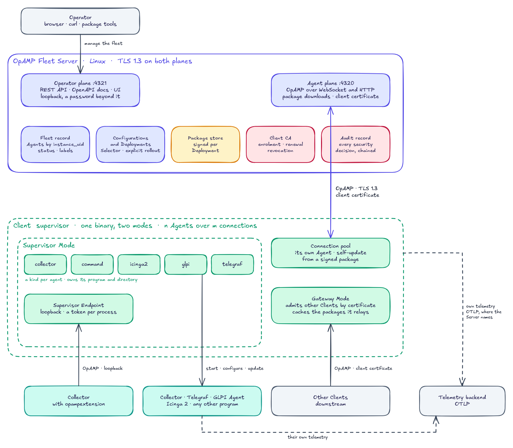

# OpAMP Fleet

[](https://github.com/mbrigl/opamp-fleet/releases/latest)
[](https://github.com/mbrigl/opamp-fleet/actions/workflows/ci.yml)
[](https://github.com/mbrigl/opamp-fleet/actions/workflows/checks.yml)
[](https://github.com/mbrigl/opamp-fleet/actions/workflows/audit.yml)
[](#license)

**OpAMP Fleet** is a Rust implementation of OpenTelemetry [OpAMP](https://opentelemetry.io/docs/specs/opamp/)-based
fleet management: an API-first **Server** that manages a fleet over the protocol and exposes an
OpenAPI-described REST API for any UI or portal, and a **Client** that supervises many managed
processes at once — OpenTelemetry Collectors and, through plugins, foreign agents that do not speak
OpAMP — and that can equally run as a **gateway** multiplexing other clients upstream. The work is driven by a written
**specification** ([`docs/SPECIFICATION.md`](docs/SPECIFICATION.md)) and **Architecture Decision
Records** ([`docs/adr/`](docs/adr/)), so intent and the reasoning behind every structural choice stay
explicit and reviewable. How much of the protocol each end implements is tracked in
[`docs/CONFORMANCE.md`](docs/CONFORMANCE.md); candidate measures for hardening the Client–Server
link further are collected — as a backlog, not as decisions — in
[`docs/HARDENING.md`](docs/HARDENING.md).

> **📖 Running it? Read the [User Manual](docs/manual/README.md)** — what each end can do, how to
> start it, and every configuration key, split into [Server](docs/manual/server.md) and
> [Client](docs/manual/client.md). Setting up a fleet for the first time? Start with
> [Setting up a fleet](docs/manual/setup.md): the certificates, both configurations, and enrolment,
> in order.

> For agent instructions, see [`AGENTS.md`](AGENTS.md) — the single source of truth for all coding agents.

## Overview

A telemetry fleet is a heap of agents on a heap of machines, each configured by a local file. That
works for one agent and breaks down for a fleet: changing what a hundred agents do means reaching a
hundred machines, and nobody can say with certainty what each one is *actually* running. Configuration
drifts, rollouts are ad-hoc, and a bad configuration shows up as missing telemetry rather than as a
report.

[OpAMP](https://opentelemetry.io/docs/specs/opamp/) — the Open Agent Management Protocol — closes that
loop: an agent accepts configuration over the protocol and reports back what it applied and how it is
doing. **OpAMP Fleet** is a Rust implementation of both ends, built for a *heterogeneous* fleet —
OpenTelemetry Collectors **and** agents that were never built to speak OpAMP:

- **Server** — an API-first control plane (Linux). It holds the configuration the fleet should run,
  tracks what each agent reports back, and only reconfigures an agent whose configuration actually
  differs. Its contract is an **OpenAPI-described REST API**, so any UI or portal can read the fleet's
  state and change what it runs; the Server ships only a rudimentary UI of its own and is built to be
  integrated into an existing portal.
- **Client** — one process, installed as a native operating-system service on Linux, macOS, and
  Windows and able to update its own binary in place. It has two **modes**, independent of each other
  and combinable on the same host: **Supervisor Mode** runs **many supervisors at once**, each
  managing one process, applying the configuration it is sent and reporting health and effective
  configuration back; **Gateway Mode** accepts other clients' OpAMP connections and folds them onto a
  small pool of upstream ones, so a fleet can grow past one connection per agent. Every supervisor
  also exposes a **Supervisor Endpoint** on loopback — not a mode of its own, but part of what a
  supervisor is — because the Collector's `opampextension` is a *client only* and needs something to
  connect to; a Collector carrying it reports through that endpoint instead of being watched from
  outside. A Collector supervisor manages a Collector natively; a
  **custom supervisor** manages a **foreign agent** — an agent of a kind the project does not already
  know, needing a plugin written for it — by translating its lifecycle into the protocol.
- **Plugins over a hexagonal core** — supervisors are plugins behind stable ports. Bringing a new kind
  of process under management means writing a plugin, not changing the core, so the same control loop
  reaches agents OpAMP was never designed for.
- **The protocol, in full and on the record** — both ends implement OpAMP as completely as the
  protocol allows, against a pinned upstream version, with every capability's status and maturity
  written down in [`docs/CONFORMANCE.md`](docs/CONFORMANCE.md) rather than left to be discovered.

The goal is one place — reachable by any UI — to decide what every agent in the fleet runs and to see
what each one is really running, whether or not it speaks OpAMP. The full problem statement, goals,
vocabulary, and non-goals live in the **specification** ([`docs/SPECIFICATION.md`](docs/SPECIFICATION.md));
the reasoning behind each structural choice lives in the ADRs ([`docs/adr/`](docs/adr/)).

## Architecture

The picture keeps the shape of the [OpAMP reference architecture](https://opentelemetry.io/docs/specs/opamp/)
— a supervisor owning a Collector, exchanging OpAMP with a backend — and extends it with what makes
OpAMP Fleet different: an **API-first Server** on two listeners, whose contract is an OpenAPI REST
API, a single **Client** whose two modes compose freely, **Supervisors** whose compiled-in kinds
each know their agent behind a hexagonal core — each exposing a **Supervisor Endpoint** for a
Collector that speaks the protocol itself — and a **Connection Pool** that carries many Agents over
few connections, every one of them admitted by a client certificate.



*The image carries its [Excalidraw](https://excalidraw.com) scene: open the PNG there to edit it,
and export it again with "Embed scene" switched on.*

On the wire the Server sees only **Agents**, told apart by `instance_uid` and never by the connection
that carried them — so whether an Agent is a Supervisor running a Collector or a Foreign Agent, a
Collector reporting through its own `opampextension`, or a Client several hops away behind a
Gateway is invisible to it. Every connection to the **Agent plane** is TLS 1.3 with a client
certificate, which the Server's client CA issues once an operator approves a host's enrolment and
renews by itself afterwards; the **Operator plane**, where the REST API and the UI live, is a
listener of its own and stays on the loopback unless it is published behind a password. The
Supervisor Endpoint is bound to loopback and admits only the process its Supervisor started, by a
token. A Supervisor's **kind** is the authority on its agent: `collector` serves every Collector,
with or without the extension; `command`
runs any other program and observes it from the outside. Adding a new kind of managed process
means writing another kind against the same ports — the core does not change. The terms used here
(Server, Client, Agent, Client Modes, Supervisor Endpoint, Connection Pool, Foreign Agent, Plugin, Port,
Selector, Package, Deployment, …) are defined in [`docs/SPECIFICATION.md`](docs/SPECIFICATION.md).

## Prerequisites

- [VS Code](https://code.visualstudio.com/) with the
  [Dev Containers](https://marketplace.visualstudio.com/items?itemName=ms-vscode-remote.remote-containers)
  extension, or any DevContainer-compatible IDE
- Docker / Podman (rootless) available on the host

## Getting Started

1. Open the repository in VS Code and choose **Reopen in Container**. The Dev Container and the
   preconfigured agent extensions build automatically, and the container enables the repository's
   git hooks ([`.githooks/`](.githooks/)): no commit on `main`, and the checks run before a push.
   Working outside the container? Enable them yourself, once per clone:
   `git config core.hooksPath .githooks`.
2. Authenticate your coding agent inside the container (for Claude Code: `claude login`).
3. Start working with the agent. Drive the work from the specification and the ADRs.

## Build, Test & Run

The toolchain is **Rust stable**, provided by the Dev Container; the code is one Cargo workspace 
with five crates — `opamp` (the OpAMP communication layer, publishable on its own, with an Agent's
client and a server endpoint with their TLS and listener behind the `client` and `server` features,
ADR-0010),
`fleet-core` (what both ends share beyond the protocol), `fleet-server` (the Server),
`fleet-agent` (the Client, in all its modes), and `fleet-tools` (the operator command-line tools, ADR-0010). 
This section is the single source for build/test/run commands — both humans and agents rely on 
it (AGENTS.md links here).

- **Build:** `cargo build --workspace`
- **Test:** `cargo test --workspace`
- **Lint:** `cargo fmt --all --check && cargo clippy --workspace --all-targets -- -D warnings`
- **Lint `opamp` per feature:**
  `for f in "" client server; do cargo clippy -p opamp --all-targets --no-default-features --features "$f" -- -D warnings; done`
  — inside the workspace Cargo builds `opamp` once with every feature any crate asks for, so only a
  build of each feature on its own shows that it stands alone (ADR-0010).
- **Lint and test `fleet-agent` with fewer Supervisor kinds:**
  `cargo clippy -p fleet-agent --all-targets --no-default-features -- -D warnings && cargo test -p fleet-agent --no-default-features`
  — a wrapped kind, when the code base carries one, is a feature, so only these show that a build leaving
  one out compiles and refuses its `type` (ADR-0017).
- **Check the Windows build:**
  `cargo xwin clippy -p fleet-agent --all-targets --target x86_64-pc-windows-msvc -- -D warnings`
  (needs `cargo install cargo-xwin` and `rustup target add x86_64-pc-windows-msvc`; the Dev
  Container carries the `llvm-lib` it requires). Worth running whenever a change touches
  platform-gated code or the tests around it: CI builds the Client on Windows and macOS, and a
  `#[cfg(unix)]` mistake compiles perfectly well on Linux.
- **Check the supply chain:** `cargo deny check` (needs `cargo install cargo-deny`): advisories,
  licences, sources and banned crates, as [`deny.toml`](deny.toml) sets them; reviewed advisories
  are recorded there with a reason
- **Fuzz a parser:** `cargo +nightly fuzz run <target> fuzz/corpus/<target> fuzz/seeds/<target>`
  (needs `cargo install cargo-fuzz` and a nightly toolchain); the targets are listed in
  [`fuzz/Cargo.toml`](fuzz/Cargo.toml), and every parser that reads bytes from the network or a
  downloaded artifact has one (specification Q-2)
- **Check interop against `opamp-go`:**
  `cargo test -p fleet-agent --test interop_opamp_go -- --ignored --nocapture --test-threads=1`
  (needs a Go toolchain on `PATH`, which nothing else here needs and the Dev Container does not
  ship); the scheduled `Interop` workflow runs it weekly, and
  [`interop/README.md`](interop/README.md) says what it covers and how a red run is triaged
  (ADR-0011)
- **Make development certificates:** `scripts/dev-pki.sh` — both binaries refuse to run without
  TLS (ADR-0013); it runs the operator tool's `opamp-fleetctl pki init` (ADR-0028), no other tool,
  and writes the set and a `server.toml` and `supervisor.toml` that use it to `.dev-pki/`. The
  development Client enrols with the bootstrap certificate; `scripts/seed_test_configs.sh --enrol` approves it.
  The VS Code launch configurations run it when `.dev-pki/` has no configuration yet
- **Run the Server:** `cargo run -p fleet-server -- --config .dev-pki/server.toml`
- **Run the Client:** `cargo run -p fleet-agent -- --config .dev-pki/supervisor.toml`
- **Run the operator tool:** `cargo run --bin opamp-fleetctl -- package fetch` (fetch a known
  agent's release and hand it to the Server), `cargo run --bin opamp-fleetctl -- package --help`
  (build, hash, and sign an artifact out of any program) or `cargo run --bin opamp-fleetctl -- pki
  --help` (the fleet's certificates) — documented in [the manual](docs/manual/tools.md). Every
  release also publishes it for Linux and macOS (ADR-0028).

Both binaries read a TOML configuration file ([ADR-0010](docs/adr/0010-five-crates-the-whole-opamp-communication-layer-in-the-opamp-crate-and-toml-configuration.md));
every setting has a default except the TLS material, without which neither starts. The annotated
examples live in [`config/`](config/). [`scripts/check-rust.sh`](scripts/check-rust.sh) runs exactly these
build/test/lint commands, locally through `scripts/check-all.sh` and in CI as the `rust` job of
[`.github/workflows/checks.yml`](.github/workflows/checks.yml);
[`.github/workflows/ci.yml`](.github/workflows/ci.yml) additionally checks the Client on Windows and
macOS and release-builds the Client for Linux, Windows, and macOS and the Server for Linux.

**Releases** ([ADR-0019](docs/adr/0019-the-client-supervisor-installed-service-releases-and-installers.md),
[ADR-0012](docs/adr/0012-versions-resolved-in-the-internal-crate.md)): the version is
`[workspace.package] version` in [`Cargo.toml`](Cargo.toml), and the `Release` workflow makes the
`version/*` tag from it before it builds — so bumping the version is an ordinary reviewed commit and
nobody types a tag. Running it publishes one archive per platform,
`supervisor_<version>_<os>_<arch>.tar.gz` for Linux, macOS and Windows on the architectures each
ships on, a CycloneDX SBOM `<stem>.cdx.json` beside each archive of the Client and of the operator
tool, and a `SHA256SUMS` file. Every asset is a subject of one build-provenance attestation, which
the workflow verifies before it creates the release
([ADR-0045](docs/adr/0045-every-release-asset-carries-a-provenance-attestation-and-every-program-an-sbom.md));
an operator checks a download with
`gh attestation verify SHA256SUMS --repo mbrigl/opamp-fleet --signer-workflow mbrigl/opamp-fleet/.github/workflows/release.yml`
and then `sha256sum -c --ignore-missing SHA256SUMS`. The files are named after the **Set** an operator uploads them
to, not after the product inside them
([ADR-0019](docs/adr/0019-the-client-supervisor-installed-service-releases-and-installers.md)) — and the program inside them and its configuration
file are called `supervisor` too. The dpkg/rpm/MSI package and the service carry
the **product's** name, `opamp-fleet`
([ADR-0019](docs/adr/0019-the-client-supervisor-installed-service-releases-and-installers.md)): that is the name that
identifies an *installation*, and a second one is a second build rather than a flag. The fields are separated by `_` because a name and a version both
contain `-` ([ADR-0019](docs/adr/0019-the-client-supervisor-installed-service-releases-and-installers.md)),
and the last two are exactly what an Agent reports as `os.type` and `host.arch` (`linux_amd64`,
`darwin_arm64`, …), so uploading a whole release under one package
name needs no translation ([ADR-0026](docs/adr/0026-packages-signed-deployments-offered-downloads-and-verified-delivery.md)). Started with `dry_run` (the default) it builds and packs everything and
publishes nothing. Before it builds anything at all it checks that the version is still free — a
`version/*` tag or a release already carrying that number fails the run on the spot, dry or not, so a
forgotten bump costs seconds rather than five build jobs — and the built binary must report the
version the artifacts are named after. Each archive is also a
ready package artifact: the same file an operator downloads is the one a fleet is handed for a Client
[self-update](docs/manual/client.md#updating-the-client-itself).

## Usage

This section is a tour. The complete operator reference — every option and every configuration key
of both ends — is the **[User Manual](docs/manual/README.md)**:
[Setting up a fleet](docs/manual/setup.md) · [Server](docs/manual/server.md) ·
[Client](docs/manual/client.md) · [Command-line tools](docs/manual/tools.md).

A minimal closed control loop on one machine:

1. **Start the Server:** `cargo run -p fleet-server -- --config config/server.toml` — it serves two
   planes on two ports ([ADR-0013](docs/adr/0013-tls-1-3-plaintext-on-the-loopback-alone-and-bounded-planes-bodies-and-messages.md)).
   The **Agent plane** on `4320`: the OpAMP endpoint at `/v1/opamp` (plain HTTP **and** WebSocket,
   [ADR-0013](docs/adr/0013-tls-1-3-plaintext-on-the-loopback-alone-and-bounded-planes-bodies-and-messages.md)) and the package downloads the offers point
   at. The **Operator plane** on `127.0.0.1:4321`: the REST API under `/api/v1/`
   ([ADR-0023](docs/adr/0023-configurations-and-the-rest-api.md)), the API
   docs, and the bundled UI at `/` — on loopback, because it is open until `[rest.auth]` guards it
   with Basic credentials
   ([ADR-0021](docs/adr/0021-admission-by-a-client-certificate-alone-and-a-revocation-list-that-follows-renewal.md)).
2. **Start a Client:** `cargo run -p fleet-agent -- --config config/supervisor.toml` — it connects over
   WebSocket by default (`ws://127.0.0.1:4320/v1/opamp`), reports its description and health, and
   appears in the fleet. Point `endpoint` at an `http(s)://` URL to use the polling transport
   instead.
3. **Open the UI** at <http://127.0.0.1:4321/> — the Agent is listed as *Connected*. Press
   **Configurations**, create a Configuration with its configuration text, and press **OK**. Then
   press **Deployments**, create a deployment whose Selector (`key=value` pairs an Agent's reported
   attributes must equal, never empty) matches the Agent, add the Configuration, press **OK**, and
   press the row's **Roll out** — a Configuration reaches Agents only through a Deployment
   ([ADR-0034](docs/adr/0034-a-deployment-carries-configurations-and-is-the-one-thing-rolled-out.md)).
4. **Watch the loop close:** a WebSocket Client the Deployment claims receives the configuration
   within a second, an HTTP Client on its next poll. The Agent stores it (under its `state_dir`),
   reports it **Applied** with the matching hash, and its effective configuration shows up in the
   table. Distributing the same configuration again sends nothing — the config-hash comparison
   gates every push. An Agent receives every Configuration its Deployment holds for its type as
   named entries and merges them itself; an Agent in no Deployment is left running what it already
   runs.

The same operations are available to any portal through the REST API — the OpenAPI document at
`/api/v1/openapi.json` is the contract to generate a client from:

```console
$ curl http://127.0.0.1:4321/api/v1/agents                   # the fleet, with reported attributes
$ curl http://127.0.0.1:4321/api/v1/configurations           # every Configuration
$ curl -X PUT -H 'Content-Type: application/json' \
       -d '{"service_name": "otelcol", "body": "receivers: {}"}' \
       http://127.0.0.1:4321/api/v1/configurations/linux-base  # content for one Agent type
$ curl -X PUT -H 'Content-Type: application/json' -d '{"selector": {"os.type": "linux"}}' \
       http://127.0.0.1:4321/api/v1/deployments/linux       # aimed at a subset
$ curl -X PUT http://127.0.0.1:4321/api/v1/deployments/linux/configurations/linux-base
$ curl -X POST http://127.0.0.1:4321/api/v1/deployments/linux/rollout  # distribute

# Content the agent reads by path rather than is configured with (ADR-0023): written next to the
# configuration under its own name, never passed to the process as configuration.
$ curl -X PUT -H 'Content-Type: application/json' \
       -d '{"service_name": "otelcol", "body": "rules: []", "role": "supplementary"}' \
       http://127.0.0.1:4321/api/v1/configurations/ruleset

# A package defines a Set (ADR-0026), identified by name, Agent type, and version, with one entry
# per platform (ADR-0026); each Agent is offered the entry that fits it. Saving stages a draft —
# nothing reaches the fleet until the Set is published (ADR-0025).
$ curl -X PUT -H 'Content-Type: application/json' -d '{}' \
       http://127.0.0.1:4321/api/v1/packages/otelcol/otelcol-contrib/0.109.0
$ curl -X PUT --data-binary @otelcol-linux-amd64.tar.gz \
       http://127.0.0.1:4321/api/v1/packages/otelcol/otelcol-contrib/0.109.0/entries/linux/amd64
$ curl -X PUT -H 'Content-Type: application/json' -d '{"published": true}' \
       http://127.0.0.1:4321/api/v1/packages/otelcol/otelcol-contrib/0.109.0/publication

# Rolling back is a publication move (ADR-0026): retract the newest version, and the fleet falls
# back to the newest one still published under the same name.
$ curl -X PUT -H 'Content-Type: application/json' -d '{"published": false}' \
       http://127.0.0.1:4321/api/v1/packages/otelcol/otelcol-contrib/0.109.0/publication
```

For TLS, give the Server a certificate (`[tls]` in `server.toml`) and the Client a `wss://` or
`https://` endpoint — plus `ca_file` under `[tls]` when the certificate comes from a private CA.
The UI and the REST API can present a certificate of their own, for example from your
organization's PKI, under `[rest.tls]`; without it they present `[tls]`'s.

### Running as an OS service

The Client registers *itself* as a native service on Linux (systemd), macOS (launchd), and Windows
(SCM) — [ADR-0019](docs/adr/0019-the-client-supervisor-installed-service-releases-and-installers.md):

```console
$ supervisor service install --config /etc/opamp/supervisor.toml     # system service (root/Administrator)
$ supervisor service start
$ supervisor service status
$ supervisor service stop
$ supervisor service uninstall                                   # never deletes layout or state
```

- **One service per build:** the service is named after the product, `opamp-fleet`, with no suffix
  and nothing to look up — so the verbs above take no name at all. A second installation on one
  host is a second *build* with its own `PRODUCT_NAME`, not a runtime flag
  ([ADR-0019](docs/adr/0019-the-client-supervisor-installed-service-releases-and-installers.md)).
- **Two roots:** `--root <dir>` given alone puts everything under the one directory it names;
  nothing is ever installed to a fixed path. Without it, a Linux system install splits the
  defaults: the executable layout — `versions/supervisor-<version>-<commit>/` and the `current`
  pointer the service runs from — lives at `/opt/opamp-fleet`, while `supervisor.toml` and the
  default `state/` directory stay at `/var/lib/opamp-fleet` (SELinux never lets systemd execute a
  binary under `/var/lib`). `--data-root <dir>` names that second half explicitly. macOS, Windows
  and user scope keep one directory for everything — including a Windows host installed by the
  MSI, where `Program Files` holds the delivered payload and the layout goes under
  `%ProgramData%\opamp-fleet`, because the self-update rewrites the layout at runtime and
  `Program Files` is not a tree a service account should be able to write.
- **Scope:** `--user` targets the user-level manager (development); the default is a system
  service that starts at boot.
- Stopping the service sends the OpAMP `agent_disconnect` goodbye (`SIGTERM` on Unix, an SCM stop
  control on Windows); after a crash the manager restarts the service, after an explicit stop it
  stays down.
- **Self-update** ([ADR-0018](docs/adr/0018-the-client-updates-itself-under-its-own-agent-type.md)): the Client is always its own
  Agent, so the Server can see which version each host runs. Letting the Server *replace* that
  version is a consent that stands by default, takes effect once a verification key is set, and
  takes only the package named after the Client's own Agent type, `supervisor` — anything else is
  refused, because a package aimed at the whole fleet would otherwise be written over the Client
  itself:

  ```toml
  [packages]
  self_update = true               # the default; false keeps this Client's update manual
  verification_key = "<hex-encoded Ed25519 public key>"
  ```

  A new version is staged beside the running one under `versions/`, run once to prove it is this
  program at the version offered, and switched to by moving `current`. The Client then exits and
  the service manager starts the new version; one that does not reach the Server within a few
  restarts is rolled back to its predecessor, and either outcome is reported to the Server by
  whichever version came up.

The **`Service smoke` workflow** exercises the real thing on an ephemeral runner — install, start,
the Agent appearing in the fleet, its process killed and brought back by the manager, an explicit
stop that stays stopped, uninstall. It runs nightly and on demand rather than per push (it installs
a system service and waits on timers), currently on Windows, where the restart is the Client's own
doing and nothing else asserts it. The test is `crates/fleet-agent/tests/service_smoke.rs`; it is
`#[ignore]`d, so an ordinary `cargo test` never installs anything.

What still needs a human, per platform: starting at **boot** (a runner never reboots), the logs
(`journalctl -u opamp-fleet` on Linux, Console/`log show` on macOS), the Agent in
the fleet UI, and an **SELinux-enforcing host** (Fedora, RHEL, or SUSE 16 with `getenforce`
answering `Enforcing`): the `.rpm` install must start — a service dying with `status=203/EXEC` and
an AVC denial in `ausearch -m avc` is the failure ADR-0019 clause 8 exists to prevent. Each wrapped
kind — Telegraf, Icinga 2 with its plugins, GLPI Agent with its tasks — under the packaged account
`opamp-fleet` and under `--run-as root`: it starts, reports, and its `sudo` or setuid helpers still
work ([ADR-0042](docs/adr/0042-the-linux-packages-run-the-client-under-its-own-account.md)). Known platform gaps (tracked in the ADR):
launchd `status` is advisory and `install` does not auto-start there. The SCM still discards a
Windows service's stderr, but the service now writes its own rotating log under
`<state_dir>/logs` on every platform (ADR-0019), which is where to look when the manager shows a
service that will not start.

## Project Layout

```
README.md             # overview & setup for humans
CHANGELOG.md          # operator-facing changes: what an upgrade needs edited or moved
AGENTS.md             # single source of truth for coding agents
docs/manual/         # the user manual: setting up a fleet, then Server, Client, and the operator tools, option by option
docs/SPECIFICATION.md # the specification: problem, goals, vocabulary
docs/GLOSSARY.md      # the vocabulary everyone uses, kept current inline
docs/CONVENTIONS.md   # how this project writes what no check decides, kept current inline
docs/ARCHITECTURE.md  # the system as it currently stands
docs/CONFORMANCE.md   # OpAMP Protocol Baseline + capability conformance matrix
docs/HARDENING.md     # candidate hardening measures for the Client-Server link (a backlog, not decisions)
docs/adr/             # Architecture Decision Records (+ template)
crates/               # Cargo workspace: opamp (shared) · fleet-core · fleet-server · fleet-agent · fleet-tools (operator CLIs)
config/               # annotated example configuration files (server.toml, supervisor.toml)
scripts/              # consistency checks and sensors (check-all.sh runs them all), run in CI
scripts/check-docs.sh # documentation & protocol-baseline consistency checks
interop/              # the Go side of the interop check against opamp-go (ADR-0011)
observability/        # the development observability stack — Collector, ClickHouse, Grafana — run on the host
rust-toolchain.toml   # pinned Rust toolchain (an exact stable release + rustfmt + clippy)
.githooks/            # git hooks: refuse a commit on main and a push while the checks are red
.github/              # CI workflows, Dependabot, issue & pull request templates
.devcontainer/        # Dev Container definition (base image + Features + the OTLP forwarder)
.vscode/              # shared editor settings
.editorconfig         # editor-neutral formatting baseline
.gitattributes        # line-ending normalization (LF everywhere)
.agents/skills/       # the procedures of AGENTS.md as Agent Skills, one directory each (ADR-0005)
.claude/CLAUDE.md     # pointer for Claude Code to read AGENTS.md
.claude/skills/       # pointers (one symlink per skill) for Claude Code to read .agents/skills/
.claude/settings.json # Claude Code permissions: deny reading .env files (see SECURITY.md)
```

## Dev Container

The environment is defined by [`.devcontainer/devcontainer.json`](.devcontainer/devcontainer.json):
a prebuilt base image with Dev Container Features and VS Code extensions layered on top — no Dockerfile. Customise it by
adding Features, switching the base image, or adding extensions. Features are pinned by major tag
and resolved in the committed `devcontainer-lock.json`. Extensions are listed by identifier only,
because a published extension version cannot be repointed and a version suffix is VS Code-specific.

### The observability stack runs beside it

The development observability stack — Collector, ClickHouse and Grafana — is a Compose project of
its own in [`observability/`](observability/README.md). It runs on the **host**, apart from the
container, and is started when you want it:

```sh
docker compose -f observability/compose.yaml up -d     # on the host, from the repository root
```

The container reaches the Collector through the host. Since the Client sends own telemetry in
plaintext to a loopback IP literal alone ([ADR-0016](docs/adr/0016-what-an-agent-reports-about-itself.md)),
[`.devcontainer/forward-otlp.sh`](.devcontainer/forward-otlp.sh) puts the host's Collector on the
container's loopback on every start: `http://127.0.0.1:4318` inside the container is the Collector
on the host, so a `server.toml` naming `http://127.0.0.1:4318/v1/logs` means the same thing in both
places. Grafana is on <http://localhost:3001> in the host's browser.

### Host container management

The Dev Container deliberately has **no access to the host Docker daemon**: the socket is not
mounted ([ADR-0002](docs/adr/0002-dev-container-runtime.md)). To manage the host's containers from
VS Code, run the **Container Tools** extension (`ms-azuretools.vscode-containers`) on the **host**
side: install it in your host VS Code. [`.vscode/settings.json`](.vscode/settings.json) already pins
it to run locally via `remote.extensionKind`, so it keeps talking to the host engine even when this
folder is reopened in the container.

## Coding Agents

This Dev Container preinstalls the **Claude Code** and **Mistral Vibe** VS Code extensions (see
[`.devcontainer/devcontainer.json`](.devcontainer/devcontainer.json)); other agents (OpenAI Codex,
Cursor, OpenCode, GitHub Copilot) work too once you add them.

The rules every agent follows live in [`AGENTS.md`](AGENTS.md); that there is exactly one such file
is decided in [ADR-0001](docs/adr/0001-agent-governance-model.md). An agent that cannot read it
natively gets a pointer file instead. [`.claude/CLAUDE.md`](.claude/CLAUDE.md) is the one shipped
here; it carries the pointer and no rules of its own ([`AGENTS.md` §3](AGENTS.md#3-adr-rules)). It
exists for one gap only: Claude Code loads `CLAUDE.md`, not `AGENTS.md`, tracked upstream as
[anthropics/claude-code#34235](https://github.com/anthropics/claude-code/issues/34235). Once that
lands, delete the pointer file rather than keeping a second file to maintain.

The procedures those rules name (proposing an ADR, planning a feature, reviewing a change,
revising the design) are Agent Skills under [`.agents/skills/`](.agents/skills/), the open format
and the directory Codex, Gemini CLI, and Cursor read
([ADR-0005](docs/adr/0005-procedures-as-skills.md)). An agent invokes one by name (`/review`) or
picks it up when the task matches its description. Claude Code reads `.claude/skills/` only, so
that directory holds one symlink per skill into `.agents/skills/`; a directory-level symlink is
not followed. The symlinks are pointers of the same kind as `CLAUDE.md`, tracked upstream as
[anthropics/claude-code#31005](https://github.com/anthropics/claude-code/issues/31005). Delete them
when that lands, and add one for every skill added meanwhile; the documentation check fails on a
skill without its pointer. A rule is enforced only by what every agent hits: the git hooks under
[`.githooks/`](.githooks/), the checks, and the repository settings below. A tool's own
configuration is not used to enforce one, because a gate that one agent honours and the next does
not looks like a rule and is not one.

## Repository settings

Some of this project's rules cannot be enforced by files in the repository
([`AGENTS.md` §6](AGENTS.md#6-project-rules)). They are settings on the GitHub repository itself,
configured once by a maintainer and worth re-checking after a repository move or transfer:

- a **ruleset on `main`** that requires pull requests with one approving review, requires the
  <!-- required-checks begin — compared with the workflow's jobs by scripts/check-docs.sh -->
  `docs`, `traceability`, `devcontainer`, `actions`, `sensors`, `shell`, `rust`,
  `client-windows`, and `client-macos`
  <!-- required-checks end -->
  jobs as required status checks — every job of the **Checks** workflow, and the Client's
  Windows and macOS jobs of the **CI** workflow (rulesets list checks by their job name) — and
  blocks force pushes and branch deletion;
- enable **secret scanning with push protection**, the only mechanical backstop behind the secrets
  rule ([`AGENTS.md` §7](AGENTS.md#7-secrets)), which is otherwise carried by review alone;
- enable **private vulnerability reporting** (see [`SECURITY.md`](SECURITY.md)).

## Template

- **Template release:** unreleased — the release of [NUC](https://github.com/hivevm/nuc) this
  repository carries; a project moves the line when it takes up a later one
  ([ADR-0008](docs/adr/0008-template-releases.md)).

## Contributing

See [`CONTRIBUTING.md`](CONTRIBUTING.md) for the workflow (specification- and ADR-driven, small
reviewable changes) and [`CODE_OF_CONDUCT.md`](CODE_OF_CONDUCT.md) for the community standards we
expect of everyone taking part. Security issues: please follow [`SECURITY.md`](SECURITY.md) instead
of opening a public issue.

## License

Licensed under either of the [MIT License](LICENSE-MIT) or the
[Apache License 2.0](LICENSE-APACHE), at your option — see also [`NOTICE`](NOTICE).
