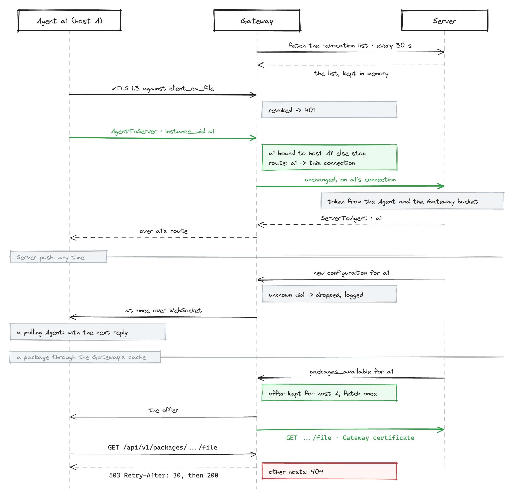
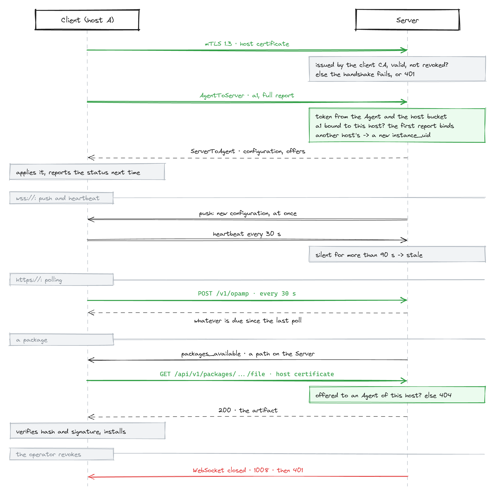

# The Client

[← User Manual](README.md) · [← The Server](server.md)

The Client is what runs on a managed host: one process, installed as a native
operating-system service on Linux, macOS, and Windows, that supervises local
processes, applies the configuration the Server sends them, reports back what
they are doing, and can replace their binaries — and its own.

Everything about the Client is on this page: what it does, how it is built, how
to run it, where it puts things, and every configuration key.

**Understand it:**

- [What the Client does](#what-the-client-does)
- [How it is built](#how-it-is-built)

**Run it:**

- [Running it](#running-it)
- [Running it as an OS service](#running-it-as-an-os-service)
- [On-disk layout](#on-disk-layout)

**Configure it:**

- [Configuration reference](#configuration-reference)
- [Gateway Mode: carrying other Clients](#gateway-mode-carrying-other-clients)
- [Supervisors: putting a process under management](#supervisors-putting-a-process-under-management)
- [Path placeholders](#path-placeholders)

**Keep it current:**

- [Package updates](#package-updates)
- [Agents that are more than one file](#agents-that-are-more-than-one-file)
- [Updating the Client itself](#updating-the-client-itself)

**When something is wrong:**

- [Connecting to the Server](#connecting-to-the-server)
- [Its own telemetry](#its-own-telemetry)
- [Troubleshooting](#troubleshooting)

## What the Client does

- **Presents one or more Agents to the Server.** The Client is always its own
  Agent, whether or not it supervises anything, so the Server can see which
  version each host runs. Each configured Supervisor is an additional Agent. All
  of them share one connection. The Client's own Agent reports `supervisor.toml`
  itself as its effective configuration — with secret values masked as `***`
  (`[packages]`'s `archive_key`, and `bearer_token` and `password` should a
  leftover `[auth]` still hold them), since the Server persists what it
  receives.
- **Supervises processes**: starts them, watches them, restarts them on a
  configuration change or a Server-issued restart command, stops them gracefully
  on shutdown.
- **Applies received Configurations**: writes each entry to disk under its
  Configuration's name, points the process at it, and reports the configuration
  applied or failed with the hash it applied.
- **Reports health, effective configuration, and version** of each Managed
  Process, and relays the `service.*` attributes a Collector carrying the
  `opampextension` reports about itself.
- **Installs Server-offered packages** over a Managed Process's binary — signed,
  verified, health-gated, and rolled back if the new version will not stay up.
  It takes packages only while `[packages] verification_key` is set.
- **Updates its own binary** from a signed package while it consents, which it
  does by default, staging the new version beside the running one and asking the
  service manager for a restart.
- **Accepts Server-offered connection settings**: a heartbeat interval, an
  endpoint, or a newly issued client certificate, which it verifies by
  connecting before it switches.

## How it is built

The sections below are the load-bearing ideas — what each buys and where each
stops. Skip to [Running it](#running-it) if you only need to operate a host;
come back when something the Client did surprised you and you want to know
whether it was supposed to.

### One process, several Agents

The unit the Server manages is an **Agent**, and one host usually has more than
one. The Client is always an Agent itself; every process it supervises is
another. All of them share a single connection to the Server.

This is why the fleet view has more rows than you have machines, and why the
thing you target with a Selector is not "a host" but an Agent on it.

The multiplexing is possible because **`instance_uid` is the only routing key**.
Nothing on either end is keyed to a connection, which means a connection can
drop and reappear, or an Agent can move between connections, without anything
having to be re-established. It is also what makes Gateway Mode work at all: a
Gateway forwards messages it does not interpret, over a pool of upstream
connections it grows lazily, each Agent sticky to one of them.

The two modes — supervising local processes, and carrying other Clients' traffic
— are independent and compose freely. One binary does both, or either, or
neither.

### The Client is its own Agent

Not a special case, not a separate code path: the Client presents itself the
same way it presents anything it supervises, with its own identity, its own
configuration, its own version.

Three things follow, and they are the reason for the design rather than side
effects:

- You can see which version every host runs, whether or not it supervises
  anything.
- The Client can be sent configuration the same way anything else is.
- The Client can be **updated** the same way anything else is — the update
  mechanism did not have to be invented twice.

Its effective configuration is the configuration file itself, with secrets
masked before it goes out, because the Server stores what it receives.

### Two names, and they are not interchangeable

Every Agent reports two names that are easy to confuse:

|                   | means                                                                 | example                         |
| ----------------- | --------------------------------------------------------------------- | ------------------------------- |
| **type**          | what kind of thing this is — the same on every host running that kind | `otelcol-contrib`, `supervisor` |
| **instance name** | _your_ name for this one Agent                                        | `edge-collector-3`              |

Aim at the type to reach every Agent of a kind; aim at the instance name to
reach exactly one. A package is built for a type and reaches no Agent of
another, whatever Deployment holds it; a Configuration stated for a type does
the same.

The Client's own type is `supervisor` — the Agent that supervises the others.
Its instance name defaults to a display name, deliberately not equal to the
type: if both columns of the fleet view said the same word, the distinction they
exist to draw would be invisible on exactly the hosts nobody has named yet.

Under this the identity proper is `instance_uid`, which the Agent asserts
itself. Admission to the fleet is a trust boundary at the endpoint, not a
per-Agent authorization — an Agent that gets in is believed about who it is.

### The service points at a pointer

The operating-system service is registered against `<root>/current/supervisor`,
never against a version directory. `current` is a pointer; versions sit side by
side beneath it.

That indirection is what makes an update a _pointer swap_ instead of a
re-registration. Registering would need administrative rights every time, and on
Windows the running executable is locked and cannot be overwritten in place at
all. Both problems disappear if the thing the service manager knows never moves.

The same indirection carries the command on your `PATH`, which is a symlink
through `current` — so the installed command reports the running version rather
than whichever one a package happened to deliver.

That command is named after the **product**, while the file it resolves to is
named after the **program**: `opamp-fleet` on your `PATH`, `supervisor` on disk.
The split is the same one the directories make, and it is what lets two products
built from this source sit on one host without fighting over a single `/usr/bin`
entry. From an unpacked archive there is no symlink and you run the file itself.

Where those directories live, and why the program and the data are sometimes in
different places, is [On-disk layout](#on-disk-layout).

### The configuration file has two owners

The file is TOML, hand-edited, and it fails loudly: an unknown key is refused at
startup rather than ignored, so a typo is a stopped service instead of a setting
silently not taking effect. There are no environment-variable fallbacks — what
the file says is what runs.

But the file is not entirely yours. The Server may send the `[[supervisor]]`
blocks, and when it does the Client rewrites that part of the file and leaves
the rest alone. Your endpoint, your client identity, your logging stay yours.

Three guards make that safe to have. The whole offer is **validated before
anything is written** — if one block is bad, nothing changes and the Client
reports the failure naming the block. A delivered block may name only a program
the Client owns, so a Server cannot use configuration delivery to run an
arbitrary binary on your host. And a delivered block **brings nothing that
reaches past the package signature**: it may set environment variables and
arguments only as the running block of the same name already has them, or as you
allow below; never a variable that steers which code a program loads (`PATH`,
`PATHEXT`, `COMSPEC`, `LD_*`, `DYLD_*`, `JAVA_TOOL_OPTIONS`, `PYTHONPATH`,
`PERL5LIB`, `RUBYLIB`, `NODE_PATH` and the like) and never a value pointing into
the Supervisors' own directories, whether by `${config_dir}`,
`${supervisor_dir}` or a path under the Supervisors' root.

```toml
[supervisors]
delivered_env = ["OTEL_*", "GOMAXPROCS"]   # names a delivered block may set; `*` ends a prefix
delivered_args = true                      # a delivered block may state its own arguments
```

Both default to nothing: without them the Server can change which programs run
and with which configuration, but not the environment or the command line they
run with. Allow as little as you need. A name you allow lets the Server set it
to anything outside the refused list, and `delivered_args = true` lets it pass
any argument to a signed program — one that loads a plugin named on its command
line then loads what the Server says.

The first configuration is written by the install, not by you finding a
template: `service install` can ask for what a fresh host cannot guess,
validates it, and only then registers the service. It never overwrites a file
that already exists.

### Supervising is a closed vocabulary

Every supervised process, whatever it is, is driven through the same seven
operations: install, uninstall, start, stop, update, reload, and
apply-configuration. A plugin selected by the block's `type` implements them for
one kind of program.

The vocabulary being closed is the point. A new kind of agent adds an
implementation, not a new concept — so package delivery, health gating and
rollback work for it without anyone extending them. Kinds exist for
OpenTelemetry Collectors and a generic one that runs a command; the generic one
covers most things without a plugin at all.

Each supervised process gets one directory holding everything about it: its
identity, its configuration, its program, and the staging its downloads pass
through. Keeping them together is what makes an install a rename inside one
filesystem rather than a copy across two — a rename either happened or did not.

Remove a block and that directory goes with it, whole. A directory no block
names is reported at startup and never deleted on its own, so a mistyped name
costs you a warning rather than an Agent's identity.

### The Client owns what it runs

A supervised program is always one the Client installed into that Agent's own
directory, named by a bare file name. An absolute path — a program the machine's
package manager installed — is refused at startup.

This is a real restriction and worth stating plainly: **the Client does not
supervise software it cannot replace.** A vendor agent installed by its own MSI
or by `apt` is not managed here until it has been repacked as a relocatable
package and delivered by the fleet.

What it buys is that there is exactly one kind of Managed Process. Every
capability — targeting, version rules, the health gate, rollback — applies to
all of them, and no feature has to be reasoned about twice. The alternative was
a second kind that the fleet could watch but never update, and the seam between
the two ran through every decision that touched packages.

### Packages, updates and connectivity, in one paragraph each

**Packages.** The Server decides which artifact an Agent is offered; the Client
fetches it from its own Server, verifies it by hash and by signature, unpacks it
beside the running program, swaps it in by rename, and watches whether it stays
up. If it does not, the predecessor comes back. The unit is a versioned
**Package** — the Agent type it is built for and its version, each entry signed
— held by a **Deployment** that aims it at a channel; only that deployment is
rolled out, and a Package assigned to any Agent is immutable. In full:
[Package updates](#package-updates).

**Versions.** An Agent reports two numbers that can disagree — the version its
package record claims and the version the program says it is. A Package must
move the Agent forward from the **lower** of the two and never below what the
record claims, so each number is used only in the direction it is trustworthy
for. A version an Agent reports that cannot be ordered blocks nothing on its
own. A Package's own version is SemVer, and a Supervisor takes nothing below the
highest version this Client has installed for its type:
[A Supervisor never goes back](#a-supervisor-never-goes-back).

**Updating itself.** The same machinery, with two differences that exist because
the thing being replaced is the thing doing the replacing: the staged binary is
asked what version it is before anything is committed, and the Client **does not
restart itself** — it swings the pointer and exits, leaving the restart to the
service manager whose job that is. In full:
[Updating the Client itself](#updating-the-client-itself).

**Connectivity.** The URL scheme picks the transport, and every connection off
the host is TLS 1.3. The Client proves membership with one thing: a client
certificate, whose private key never leaves the host, presented in every TLS
handshake. It sends no credential. The Server can move the fleet to a new
endpoint and renews the certificate before it expires, and the Client proves an
offered setting by connecting with it before it switches. In full:
[Connecting to the Server](#connecting-to-the-server).

### What the Client will not do

Knowing the edges is half of knowing the design.

- **It does not authorize per Agent.** Anything admitted to the endpoint is
  believed about who it is; the trust boundary is the endpoint, not the row.
- **It does not run programs it did not install.** See above — this is a
  deliberate narrowing.
- **It does not install an unsigned package**, and it takes none at all without
  a verification key.
- **It does not speak plaintext off the host.** `ws://` and `http://` are
  accepted only to `127.0.0.1` and `::1`; anything else is refused at startup,
  never warned about.
- **It does not restart itself**, on any platform.
- **It does not invent telemetry semantics.** Its own metrics and logs go out
  over OTLP as the OpenTelemetry conventions define them, and nothing beyond.
  Its traces are the one place with no convention to follow — the standard names
  none for an agent's own lifecycle — so the spans are named after the
  operations this project already has a vocabulary for, and their status is the
  standard's, not one of ours.
- **It does not keep state keyed to a connection**, which is what makes
  reconnection and gateways uneventful.
- **It does not silently accept a configuration it does not understand** — an
  unknown key stops the start.

On the last point, a related one worth knowing: a Client that cannot find its
configuration file does not carry on with the defaults. The defaults hold no
client certificate, so it refuses to start and names `[tls] cert_file` and
`key_file`. Coming up anyway would mean dialling a development endpoint and
managing nothing, which is the failure hardest to notice.

## Running it

```sh
supervisor --config /etc/opamp/supervisor.toml     # foreground; `run` is implied
supervisor run --config /etc/opamp/supervisor.toml # the same thing, said explicitly
opamp-fleet --version
```

| Global flag         | Meaning                                                                                                                                                                                                                                                                                                                                                                                                |
| ------------------- | ------------------------------------------------------------------------------------------------------------------------------------------------------------------------------------------------------------------------------------------------------------------------------------------------------------------------------------------------------------------------------------------------------ |
| `--config <path>`   | The TOML configuration file. Defaults to `supervisor.toml`. A missing file means the defaults, which hold no client certificate, so `run` refuses to start. `service install` is the one place where "not given" means something else: there the file is `supervisor.toml` inside the data root, because a path resolved against this shell's working directory is not one the service manager shares. |
| `--state-dir <dir>` | Overrides the configuration file's `state_dir`. `service install` bakes this into the unit, so an installed service never depends on a relative path.                                                                                                                                                                                                                                                  |

There are no environment-variable fallbacks for configuration — the flags say
only where the file is and which instance is meant. Logging goes to stderr and
is controlled by `RUST_LOG` (default `info`).

The Client stops on `SIGTERM`/`Ctrl-C` (an SCM stop control on Windows) and
sends the OpAMP `agent_disconnect` goodbye before it goes, so the fleet view
shows it as deliberately gone rather than as a host that fell off the network.

## Running it as an OS service

The Client registers _itself_ with systemd, launchd, or the Windows SCM — there
is no packaging step and no unit file to write:

```sh
opamp-fleet service install --config /etc/opamp/supervisor.toml   # root / Administrator
opamp-fleet service start
opamp-fleet service status
opamp-fleet service stop
opamp-fleet service uninstall      # deregisters; never deletes the install layout or state
```

| Flag                 | Applies to                          | Meaning                                                                                                                                                                                                                                                                                                                                                                                                                                                                                                                                                                                                                                                                                                                       |
| -------------------- | ----------------------------------- | ----------------------------------------------------------------------------------------------------------------------------------------------------------------------------------------------------------------------------------------------------------------------------------------------------------------------------------------------------------------------------------------------------------------------------------------------------------------------------------------------------------------------------------------------------------------------------------------------------------------------------------------------------------------------------------------------------------------------------- |
| `--user`             | every `service` action              | Target the current user's service manager instead of the system one. Useful in development; the default is a system service that starts at boot.                                                                                                                                                                                                                                                                                                                                                                                                                                                                                                                                                                              |
| `--root <dir>`       | `service install`, `service config` | The layout root: `versions/` and the `current` pointer. Given alone it also takes the data — `supervisor.toml` and `state/` — so everything lands under the one directory you named, whose file labeling is then yours to manage. Without it the defaults apply per platform and scope, and on Linux system installs they are two directories: `/opt/opamp-fleet` for the layout, `/var/lib/opamp-fleet` for the data, because SELinux never lets systemd start a binary labeled for `/var/lib`. macOS uses `/Library/Application Support/opamp-fleet`, Windows `%ProgramData%\opamp-fleet`, and user scope the user's own data directory — one directory each. No path is ever fixed. See [On-disk layout](#on-disk-layout). |
| `--data-root <dir>`  | `service install`, `service config` | The data root — `supervisor.toml` and `state/` — when it is to differ from the layout root. A packaged install, the MSI included, passes neither flag and takes the platform defaults.                                                                                                                                                                                                                                                                                                                                                                                                                                                                                                                                        |
| `--interactive`      | `service install`                   | Ask for the settings a fresh host cannot guess, write or edit the configuration file, and enrol a host that holds no certificate yet, before registering the service. See below.                                                                                                                                                                                                                                                                                                                                                                                                                                                                                                                                              |
| `--endpoint <url>`   | `service install`                   | Write the configuration file with this endpoint instead of asking for it — the same file, from an answer given rather than typed at a prompt. Mutually exclusive with `--interactive`, and it keeps an existing file untouched. `ws://` and `http://` are refused unless the host is `127.0.0.1` or `::1`. It has no siblings for the CA file or the client identity: it takes them from [beside the program](#files-beside-the-program), or they are files the operator names in the file.                                                                                                                                                                                                                                   |
| `--run-as <account>` | `service install`                   | Run the service as this account, and hand its files over to it. Without it, a re-registration keeps the account the existing registration names. `--run-as root` chooses root. See [Running it under its own account](#running-it-under-its-own-account). System scope only — a `--user` service already runs as its user.                                                                                                                                                                                                                                                                                                                                                                                                    |

### Running it under its own account

The system service — and every Managed Process its Supervisors spawn — runs as
one account, and the install hands its files over to it: the configuration file,
the state directory, **and the executable layout**. The layout too because the
self-update runs _inside_ the service — a layout the account cannot write would
silently end [server-driven updates](#updating-the-client-itself) for that host.
The account is the most a Server-delivered command, such as a Telegraf
`inputs.exec`, reaches on the host.

Which account it is:

| `service install` …                                               | runs as                                                                                  |
| ----------------------------------------------------------------- | ---------------------------------------------------------------------------------------- |
| `--run-as <account>`                                              | that account                                                                             |
| `--run-as root` (Linux, macOS)                                    | root, written as `User=root` / `UserName` `root`, so the next re-registration keeps root |
| no flag, the unit or plist names an account                       | that account, kept                                                                       |
| no flag, the unit names none, the data root belongs to an account | the data root's owner, and the install says so                                           |
| no flag, first registration                                       | root (systemd, launchd), `LocalSystem` (Windows)                                         |

The Linux packages create the account `opamp-fleet` and name it on a first
installation — see
[Installing from a native package](#installing-from-a-native-package). A
re-registration reads the account from the file the Client wrote,
`/etc/systemd/system/opamp-fleet.service` or
`/Library/LaunchDaemons/opamp-fleet.plist`, not from a drop-in. Windows keeps
the logon account the SCM holds. The install prints the account and where it
came from:

```sh
# opamp-fleet service install
installed opamp-fleet
  …
  runs as:   opamp-fleet (kept from /etc/systemd/system/opamp-fleet.service)
```

On Linux and macOS the account must already exist, named or kept; the install
refuses before it writes anything if it does not, and names the file a kept
account came from. The binary never creates an account:

```sh
# useradd --system --user-group --no-create-home --home-dir /var/lib/opamp-fleet \
    --shell /usr/sbin/nologin opamp-fleet
# opamp-fleet service install --run-as opamp-fleet
```

The hand-over never follows a link: each directory is opened as itself and
re-owned through that handle, a symbolic link is re-owned as a link, and a file
with a second hard link is left as it is and named in a warning.

On Windows only **passwordless** account forms are accepted — there is
deliberately no password flag: a flag stands in the shell history and the
process list. The recommended form is the service's own virtual account, which
Windows provisions and password-manages by itself:

```sh
> opamp-fleet service install --run-as "NT SERVICE\opamp-fleet"
```

A group-managed service account (`DOMAIN\name$`) and the built-ins
`NT AUTHORITY\LocalService` / `NT AUTHORITY\NetworkService` are accepted as
well. The install grants the account Modify on its directories; it does not
touch the _Log on as a service_ right — the default security policy grants it to
`NT SERVICE\ALL SERVICES` (covering the virtual account), the built-ins carry it
inherently, and a gMSA gets it from its domain's group policy. On a host
hardened to remove that default grant, restore the right for the account or the
service will not start.

Two consequences to weigh before using it:

- **The account is a trust boundary.** Whoever holds it can replace the binary
  in the layout, and the packaged `/usr/bin/opamp-fleet` symlink resolves
  through that layout's `current` pointer — an administrator invoking the CLI
  executes account-owned code.
- **The account's limits are the fleet's.** Under an account other than root,
  GLPI Agent's full inventory and its Deploy task, a Telegraf input without a
  `sudo` rule, a listener on a port below 1024, and a log receiver reading
  `root:adm` files fail — that trade-off is the point. Grant what is missing (a
  `sudoers` entry, `usermod -aG adm opamp-fleet`, or a drop-in, below), or
  choose root with `opamp-fleet service install --run-as root`.

Re-running `install` with a different `--run-as` re-registers and re-owns the
same directories. Without the flag it keeps the account; a plain re-install does
not return a host to root.

#### The systemd unit, and what a drop-in adds

On Linux the Client writes its system unit itself. It quotes every word of
`ExecStart=`, so a root holding a space, a `%` or a `$` works, and it carries
only the sandboxing that leaves `sudo`, setuid helpers and every supported agent
working. Most of systemd's sandboxing directives set `no_new_privs` for a unit
that does not run as root, and with it set `sudo` and every setuid helper stop
working for the service and every Managed Process.

| unit runs as | carries                                                                         |
| ------------ | ------------------------------------------------------------------------------- |
| any account  | `ProtectControlGroups=yes`                                                      |
| root         | also `ProtectKernelTunables=yes`, `LockPersonality=yes`, `RestrictRealtime=yes` |

`NoNewPrivileges=`, `ProtectSystem=`, `ProtectHome=`, `PrivateTmp=`,
`CapabilityBoundingSet=` and the rest are left out, because a supported agent
needs what each takes away. A re-registration rewrites the unit;
`service install` never touches `/etc/systemd/system/opamp-fleet.service.d/`, so
what a host can take, or must not have, goes into a drop-in there and survives
every upgrade:

```ini
# /etc/systemd/system/opamp-fleet.service.d/host.conf
[Service]
# Nothing on this host uses sudo or a setuid helper:
NoNewPrivileges=yes
# A receiver listens on a port below 1024:
AmbientCapabilities=CAP_NET_BIND_SERVICE
# Log files readable by group adm:
SupplementaryGroups=adm
```

```sh
# systemctl daemon-reload && systemctl restart opamp-fleet
```

A drop-in that removes a directive the unit sets assigns it its default, for
example `ProtectKernelTunables=no`. A `User=` in a drop-in governs the process,
but the install hands the roots to the account the unit names; name the account
with `--run-as` instead.

### Files beside the program

`service install` looks in the directory of the program it runs from for the
fleet's files, under the names the operator tools give them — or, with
`--fleet-files <dir>`, in that directory instead, never in both:

| File                                    | What the install does with it                                                                                                                                                                                                                                                                                                                                                     |
| --------------------------------------- | --------------------------------------------------------------------------------------------------------------------------------------------------------------------------------------------------------------------------------------------------------------------------------------------------------------------------------------------------------------------------------- |
| `server-ca.pem`                         | offers it as the CA certificate of the Server; without `--interactive`, copies it beside `supervisor.toml` and names it in `[tls] ca_file`                                                                                                                                                                                                                                        |
| `bootstrap.pem` and `bootstrap-key.pem` | offers them as the bootstrap pair; without `--interactive`, enrols with them and waits for an operator's approval. Both or neither: one alone is named in a warning and ignored                                                                                                                                                                                                   |
| `bootstrap.p12`                         | the bootstrap certificate and its key in one file under a password, as the Server hands it out; offered as the bootstrap certificate, and the password is asked with input hidden. Without `--interactive`, it enrols with it under the password `--bootstrap-password-file` reads. Lying beside `bootstrap.pem` or `bootstrap-key.pem`, neither identity is used, with a warning |
| `package-signing-key.pub`               | offers its content as the package verification key; without `--interactive`, writes it as `[packages] verification_key`. A file that holds no 64-digit hex key is named in a warning and ignored                                                                                                                                                                                  |

So a host is set up by copying the program and these four files into one
directory and running, from there:

```console
$ cd /root/fleet-files && sudo ./opamp-fleet service install --endpoint wss://fleet.example.com:4320/v1/opamp
took the package verification key 3b6a27bc… from beside the program
copied /var/lib/opamp-fleet/server-ca.pem
wrote /var/lib/opamp-fleet/supervisor.toml for wss://fleet.example.com:4320/v1/opamp
enrolling with /root/fleet-files/bootstrap.pem and /root/fleet-files/bootstrap-key.pem from beside the program
enrolling with wss://fleet.example.com:4320/v1/opamp: an operator approves this host's request by the key fingerprint logged below (Ctrl-C stops waiting)
INFO certificate request generated; an enrolling host waits for an operator's approval key_fingerprint=3f9a…
enrolled: the issued certificate is in /var/lib/opamp-fleet/state
installed opamp-fleet
```

A value the configuration file already holds wins over a file beside the
program, and an existing configuration is never overwritten. The CA and the
verification key are taken only for a `wss://` or `https://` endpoint, and the
bootstrap pair only while the host holds no certificate the Server issued. An
install run from a directory that holds a bootstrap pair waits for the approval;
Ctrl-C stops it and registers nothing. The files stay where they are: remove the
bootstrap pair once the host is enrolled. `service config` runs the installed
copy of the program and does not look.

**A `bootstrap.p12` needs its password.** `--bootstrap-password-file <path>`
names a file whose first line is the password; it is read once and left as it
is, and the password is never written and never sent — it only opens the file on
this host. There is no way to give it on the command line or in the environment,
where other processes could read it. The install opens the file before it writes
anything, so a missing flag, a password that does not open the file, or the flag
with no `bootstrap.p12` to open stops it with nothing changed:

```console
$ sudo ./opamp-fleet service install --endpoint wss://fleet.example.com:4320/v1/opamp \
    --bootstrap-password-file /root/fleet-files/bootstrap.pass
…
enrolling with /root/fleet-files/bootstrap.p12
```

The key it decrypts is held in memory for the enrolment and never written to
disk; what the host keeps is the key it makes for its own certificate.

### The questionnaire: `--interactive` and `service config`

A release artifact is the bare binary, so a freshly downloaded Client has no
`supervisor.toml` to edit. Without one it still installs, but the service
refuses to start: the defaults hold no client certificate. `--interactive` is
the way past that. It needs the Server reachable and its
[enrolment window](setup.md#5-enrol-the-client) open, because it enrols the host
before it registers the service:

```console
$ opamp-fleet service install --interactive        # root / Administrator
No configuration at /var/lib/opamp-fleet/supervisor.toml — answering these writes it (everything else keeps its default).
Server OpAMP endpoint [wss://127.0.0.1:4320/v1/opamp]: wss://fleet.example.com/v1/opamp
This Agent's name (service.instance.name) [Supervisor Agent]: host-01
CA certificate of the Server — the CA that signed its certificate (PEM path): /etc/opamp/ca.pem
Bootstrap certificate this Client enrols with (PEM, or a PKCS#12 .p12 path): /etc/opamp/bootstrap.pem
Private key of the bootstrap certificate (PEM path): /etc/opamp/bootstrap-key.pem
Package verification key (hex Ed25519 public key; empty takes no packages): 3b6a27bc…
copied /var/lib/opamp-fleet/server-ca.pem
wrote /var/lib/opamp-fleet/supervisor.toml
enrolling with wss://fleet.example.com/v1/opamp: an operator approves this host's request by the key fingerprint logged below (Ctrl-C stops waiting)
INFO certificate request generated; an enrolling host waits for an operator's approval key_fingerprint=3f9a…
enrolled: the issued certificate is in /var/lib/opamp-fleet/state
installed opamp-fleet
…
```

`service config` asks the same questions of an installed Client and registers
nothing. Each question offers what the file holds as its default, so Enter keeps
it; afterwards restart the service to apply what changed:

```console
$ opamp-fleet service config                       # root / Administrator
Editing /var/lib/opamp-fleet/supervisor.toml — Enter keeps the value shown (everything not asked stays as it is).
Server OpAMP endpoint [wss://fleet.example.com/v1/opamp]:
This Agent's name (service.instance.name) [host-01]: web-01
CA certificate of the Server — the CA that signed its certificate (PEM path) [/var/lib/opamp-fleet/server-ca.pem]:
enrolled: this Client holds a certificate the Server issued
Package verification key (hex Ed25519 public key; - removes it) [3b6a27bc…]:
copied /var/lib/opamp-fleet/server-ca.pem
wrote /var/lib/opamp-fleet/supervisor.toml
restart the service to apply: supervisor service stop && supervisor service start
```

It finds the file the way `install` does: `--config` when you name one, and
otherwise `supervisor.toml` in the data root of the scope — pass the `--user`,
`--root` and `--data-root` the Client was installed with. The file has to load
before anything is asked; one that does not parse is corrected by hand, and the
error names it.

What the questionnaire asks about is only what has no useful default on a fresh
host:

- **the endpoint**, suggesting `wss://127.0.0.1:4320/v1/opamp`. A `ws://` or
  `http://` endpoint is refused unless its host is `127.0.0.1` or `::1`, and the
  question is asked again;
- **the Agent's name**;
- **the CA certificate of the Server**, the CA that signed its certificate,
  whenever the endpoint is `wss://` or `https://` ([`[tls]`](#tls)). It is
  copied beside `supervisor.toml` as `server-ca.pem`, owner-only, and the file
  names the copy; the original can be removed afterwards;
- **the bootstrap certificate and its private key, only while the host is not
  enrolled** — while its state directory holds no `client-cert.pem` and
  `client-key.pem`. They are neither copied nor written into the file: the
  questionnaire [enrols](#enrolment-the-first-certificate) with them where they
  lie, logs the request's key fingerprint and waits until an operator approves
  it, then stores the issued certificate in the state directory. Ctrl-C stops
  the wait; the file stays written, nothing is registered, and running the
  questionnaire again asks again and resumes the same request, printing its
  fingerprint. A request an operator rejected stays rejected: the Server's
  refusal is logged and the wait goes on, so stop it, delete
  `client-key.pending.pem` and `client-csr.pending.pem` from the state
  directory, and run the questionnaire again for a fresh request. A path that
  names no readable file, here or for the CA, is asked for again;
- **the package verification key** ([`[packages]`](#packages)). It also decides
  whether the Server may update this Client: a new file is written with
  `self_update = true`, which takes effect once a key is set. An empty answer is
  accepted, and the questionnaire then says that this Client installs no
  package, its own update included, until a key is set. Where the file holds a
  key, `-` removes it.

A new file gets everything else as commented defaults. An existing file is
edited in place: only the keys asked about change, and every other key, every
comment, the `[[supervisor]]` blocks and the self-update consent stay as you
wrote them. No question asks for a credential, and the questionnaire writes no
`[auth]` section; on Unix the file is mode `0600` and keeps its owner.

Four rules worth knowing before you script around it:

- **Interactivity is never assumed.** Without the flag, `install` asks nothing
  and never touches an existing file. It prints a warning when the path it is
  about to bake into the unit holds no file, or a file without a client
  certificate.
- **Defaults are what is there.** Re-running `--interactive` or `service config`
  on a configured host offers every answer typed into the first one, or edited
  since, and keeps whatever it does not ask about.
- **No terminal, no questionnaire.** `--interactive` or `service config` in a
  provisioning run, a container build, or a pipeline fails with a message
  instead of blocking forever on an answer nobody can give.
- **Where it writes:** the path from `--config` when you name one, and otherwise
  `supervisor.toml` inside the data root. The file is validated by the ordinary
  loader before the service is registered; a file that does not parse, or a
  plaintext endpoint off the loopback, fails the install, and the file stays on
  disk for you to correct.

Where there is an answer but no terminal — a provisioning run, an MSI dialog, a
`%post` script — `--endpoint` writes the same file without asking:

```console
$ opamp-fleet service install --endpoint wss://fleet.example.com/v1/opamp
wrote /var/lib/opamp-fleet/supervisor.toml for wss://fleet.example.com/v1/opamp
warning: /var/lib/opamp-fleet/supervisor.toml: [tls] cert_file and key_file are required — … The service is registered, and refuses to start until this is set (or re-run with --interactive).
installed opamp-fleet
…
```

It writes only the endpoint; everything else keeps its default. The service is
registered, and it refuses to start until you add the client certificate and its
key ([`[tls]`](#tls)) to the file. All four rules above hold unchanged — in
particular, an existing file is kept.

### Installing from a native package

A release also ships a `.deb`, an `.rpm` and an `.msi`. They deliver the binary
to `/usr/libexec/opamp-fleet` (Windows: the folder you choose) and then run
`service install` themselves — the layout, the unit and the SCM entry are the
same ones this page describes, because they are made by the same command. No
package ships a unit file of its own. What lands on `PATH` —
`/usr/bin/opamp-fleet` — is a symlink through the layout's `current` pointer, so
the command you type is always the binary the service runs.

```sh
sudo apt install ./supervisor_1.2.3_linux_amd64.deb
sudo dnf install ./supervisor_1.2.3_linux_amd64.rpm
```

**The service is registered and left stopped.** That is deliberate: a Client
with no configuration holds no client certificate, and it is refused at startup.
Two steps remain:

```sh
sudo opamp-fleet service install --interactive
sudo systemctl start opamp-fleet
```

The first asks for the endpoint, the client certificate and its key, and the
verification key. `--endpoint` alone writes a file the Client refuses until you
add the certificate and its key. An upgrade of a host whose service was running
restarts it on the delivered binary.

**The `.deb` and the `.rpm` run the service under the system account
`opamp-fleet`.** The post-install creates it where it is missing — no password,
`/usr/sbin/nologin`, the data root as its home — and passes
`--run-as opamp-fleet` only when no unit is registered yet. Every upgrade runs
`service install` without the flag, which keeps the account the unit names, so a
host moved to another account or to root with `--run-as` stays there. A host
that already ran as root before the packages created the account stays root;
move it with `sudo opamp-fleet service install --run-as opamp-fleet` and a
restart. No removal, not even a purge, deletes the account. See
[Running it under its own account](#running-it-under-its-own-account) for what
an account cannot do and how to grant it.

**Without a terminal**, as configuration management installs a host, the package
is installed first and the host enrolled in a step after it — the package's own
install never enrols, so `apt` and `dnf` never wait for an approval. Put the
fleet's files in a directory and name it:

```console
$ sudo dnf install -y ./supervisor_1.2.3_linux_amd64.rpm
$ sudo opamp-fleet service install --endpoint wss://fleet.example.com:4320/v1/opamp \
    --fleet-files /root/fleet --bootstrap-password-file /root/fleet/bootstrap.pass
$ sudo systemctl start opamp-fleet
```

The second step waits for an operator's approval, as every enrolment does; run
it as a task that may wait, such as an asynchronous task in Ansible, while the
enrolment window is open. Remove the directory afterwards. With a PEM pair in
it, `--bootstrap-password-file` is left out.

On Windows the `.msi` asks for the installation folder, the endpoint, and the
self-update consent. The endpoint field is prefilled with
`wss://127.0.0.1:4320/v1/opamp` in the interactive install only. The folder
holds only the delivered program; `service install` puts the layout,
`supervisor.toml` and the state under `%ProgramData%\opamp-fleet`. The same file
installs unattended with the same answers, which is how Intune, Group Policy and
SCCM deploy it:

```sh
C:\> msiexec /i supervisor_1.2.3_windows_amd64.msi /qn ^
       INSTALLFOLDER="C:\Program Files\opamp-fleet" ^
       ENDPOINT="wss://fleet.example.com/v1/opamp"
```

A silent install that names no `ENDPOINT` writes no configuration. The MSI asks
for no client identity, because the certificate and its key are files you put on
the host, and it starts no service. Name them as `cert_file` and `key_file`
under `[tls]` in `%ProgramData%\opamp-fleet\supervisor.toml`, then start the
service.

Two things to know about living with a packaged install:

- **`dpkg -l` reports the version it _delivered_, not the one that is running.**
  After a fleet self-update
  ([Updating the Client itself](#updating-the-client-itself)) the service runs
  the binary under `<root>/current/`, which no package manager owns — that
  separation is what keeps the next `apt upgrade` from silently reverting the
  Server's decision. `opamp-fleet --version` goes through `current` and answers
  for the running binary, as does the fleet view; those two are the truth.
- **Removing the package stops and unregisters the service and uninstalls every
  staged version.** `versions/` and the `current` pointer go with the package;
  the state directory and `supervisor.toml` stay, for the same reason an install
  never overwrites a configuration: it holds what you wrote, and the host's
  identity. `apt purge` deletes those too — the instance directory whole. A
  reinstall after a plain remove keeps the host's identity and configuration and
  stages its own binary fresh.

macOS has no native installer; there, unpack the `.tar.gz` and run
`service install` yourself.

### What the service is called

One name on every platform, and it is the **product's** name — not the
program's:

| Platform            | Service                       |
| ------------------- | ----------------------------- |
| **Linux** (systemd) | `opamp-fleet.service`         |
| **macOS** (launchd) | `opamp-fleet` (job and plist) |
| **Windows** (SCM)   | `opamp-fleet`                 |

So the same command works everywhere it exists: `systemctl status opamp-fleet`,
`launchctl list opamp-fleet`, `sc query opamp-fleet`.

The name is fixed when the program is built, which is why there is no flag to
change it. A second Client on one host is a second build with its own product
name, and it therefore has its own service, its own package and its own
directories — nothing about it collides with the first.

Where a platform has a second, human-readable name, it is **OpAMP Fleet Agent**.
That is the Windows services list; systemd shows the unit name as its
`Description`, and a launchd job has no name besides its label.

### Where the service's logs are

A Client started by the service manager writes its own log to
**`<state_dir>/logs/`** on every platform, one file per day, seven days kept:

```text
<state_dir>/logs/supervisor.2026-08-09.log
```

**On Windows this is the only copy there is** — the SCM discards a service's
stderr, so `sc query` telling you the service will not start is all the platform
itself offers. On Linux and macOS the same lines are also in
`journalctl -u opamp-fleet` and Console/`log show`; the file is written anyway
so the answer to "where are the logs" is the same everywhere, including in a
container where neither exists.

Running the Client **in the foreground writes no file** — stderr is right there
in front of you.

The `[logging]` section moves it, changes how many days are kept, or turns it
off:

```toml
[logging]
dir = "/var/log/opamp"   # default: <state_dir>/logs
keep = 7                 # daily files kept, then deleted
enabled = false          # write nothing; for a host whose platform already collects stderr
```

`keep = 0` is **refused at startup**. It is a retention bound, not a switch — on
a fleet host the unbounded setting is the one that eventually fills a disk, so
turning the log off is spelled `enabled = false` and cannot be reached by typing
a zero. If the directory cannot be written, the Client says so and runs anyway:
a monitoring agent that refuses to start because of its own log file has turned
a diagnostic into an outage.

This is a different thing from the Client's own telemetry (`ReportsOwnLogs`),
which ships log records to a destination the **Server** offers. That needs a
Server it can already reach — which is exactly what a bad `supervisor.toml`, an
unusable certificate, or a refused endpoint does not give it. The file on disk
is what explains those.

The Windows services list has a **Description** column beside that name, and it
is a separate field that nothing fills on its own — a service can carry a
display name and still show an empty description, which is what this one did. It
now reads **OpAMP Fleet Agent for Windows** — the display name beside it says
what the service is, and the description says what it is for.

Both are set right after the registration, with `sc.exe config` and
`sc.exe description`.

The service is registered against `current/supervisor` — a pointer, not a
version directory — so switching versions never re-registers it. Where the
layout and the data live on each platform, and what an uninstall leaves behind,
is [On-disk layout](#on-disk-layout).

After a crash the service manager restarts the service; after an explicit stop
it stays down. A known platform gap: on macOS `service status` is advisory and
`install` does not auto-start.

### Windows needs an elevated shell, and says so before it writes

Registering a machine-wide service needs Administrator, and a running process
cannot raise its own rights — there is no UAC prompt to be had from inside a
command that has already started. So `service install` asks the service control
manager up front whether this process may register a service at all, and stops
with a message naming the fix if it may not:

```sh
C:\> opamp-fleet service install
the Windows service control manager denied access: registering a machine-wide service needs
Administrator, and a running process cannot raise its own rights. Open a shell with "Run as
administrator" — from PowerShell, `Start-Process powershell -Verb RunAs` — and run this command
again. Nothing has been installed or written.
```

That the check comes _before_ the first write is the point of it:
`%ProgramData%` lets an ordinary user create folders, so an install refused only
at `sc create` had already staged a version directory and pointed `current` at
it, leaving half an install behind. `uninstall`, `start`, and `stop` write
nothing beforehand and simply report the manager's own refusal.

## On-disk layout

Where a managed host keeps things: the program, its configuration, its state,
and the Agents it supervises. One structure everywhere — only the root differs,
and on two platforms there are two of them.

### The shape

Two roots, and everything hangs off them:

```text
<layout-root>/                       the program, replaceable
  versions/<product>-<version>-<commit>/supervisor
  current -> versions/<product>-…/

<data-root>/                         everything a reinstall cannot recreate
  supervisor.toml
  state/
```

The split is worth reading twice, because it is the rule the rest of this page
follows. The **layout root holds what a package can put back**: program files,
one directory per version, and a pointer at the live one. The **data root holds
what nothing can put back**: the identity this host reports to the Server, its
client certificate and key, the configuration an operator wrote, and the
configuration the fleet sent.

Directories are named after the **product**; the file inside is the **program**.
They are not the same name and are not meant to be — two products built from
this source differ in the first and share the second, which is what lets one
published release update both.

### Where the roots are

| Platform | Scope  | Layout root                               | Data root            |
| -------- | ------ | ----------------------------------------- | -------------------- |
| Linux    | system | `/opt/<product>`                          | `/var/lib/<product>` |
| Linux    | user   | `$XDG_DATA_HOME/<product>`                | _the same_           |
| macOS    | system | `/Library/Application Support/<product>`  | _the same_           |
| macOS    | user   | `~/Library/Application Support/<product>` | _the same_           |
| Windows  | system | `%ProgramData%\<product>`                 | _the same_           |
| Windows  | user   | `%LOCALAPPDATA%\<product>`                | _the same_           |

On Linux, `$XDG_DATA_HOME` falls back to `~/.local/share` when it is unset.

`--root` overrides the layout root and, given alone, collapses both into the one
directory it names — whose file labeling and permissions are then yours to
manage. `--data-root` names the other half. A packaged install passes neither.
No path is ever compiled in.

The MSI's installation folder, `C:\Program Files\<product>` by default, is not a
root. It holds the delivered program alone; the MSI then runs `service install`,
which builds the layout and the data under `%ProgramData%\<product>`.

### Why two roots, and only sometimes

Only Linux at system scope splits, and it has a reason the other platforms lack.

**Linux at system scope** splits because of SELinux. A file created under
`/var/lib` carries a type that an enforcing policy will not let the init system
execute — the service would register cleanly and then die at its first start.
`/opt` carries a type the policy treats as an entry point for third-party
software, and files staged there later inherit it. This is why an update can put
a new version in place without any relabeling step.

**Everywhere else there is one root**, because that reason does not apply: macOS
has no equivalent restriction, and a user-scope service runs in the user's own
context. **Windows keeps one root too, whether the MSI installed it or not.**
The service's own account must be able to write the layout, because the
self-update stages into it. Granting a low-privileged account write access to a
tree under `Program Files` that it executes from would be a privilege-escalation
surface. So the layout stays under `%ProgramData%`, beside the data, and the
MSI's folder under `Program Files` holds only the program it delivered.

### Inside the layout root

```text
<layout-root>/
  versions/
    <product>-1.2.3-a1b2c3d/
      supervisor              (supervisor.exe on Windows)
      manifest.toml           the full version string and the program's hash
    <product>-1.2.2-9f8e7d6/
  current -> versions/<product>-1.2.3-a1b2c3d/
```

Every version sits beside the ones before it, and `current` points at the live
one. The service is registered against `<layout-root>/current/supervisor`, never
against a version directory — which is why switching versions never re-registers
the service.

The version part of a directory name is the plain `MAJOR.MINOR.PATCH`; a
pre-release suffix is not in the name. The trailing part is the commit the build
came from. `current` is a symlink on Linux and macOS, and a directory junction
on Windows, where junctions need no special privilege.

### Inside the data root

```text
<data-root>/
  supervisor.toml           the file you edit
  server-ca.pem             the copy of the answered CA, if the questionnaire wrote the file
  state/
    instance-uid            this host's identity to the Server
    remote-config.pb        the last configuration it received
    connection-settings.pb  Server-offered settings, if any
    installed-package.json  the update it last installed, if any
    package-high-water.json the highest version installed per Agent type — see "A Supervisor never goes back"
    packages/               staging for its own update
    logs/                   the service's rotating log
    supervisors/            one directory per Agent — see below
```

`instance-uid` is the file that matters most. It is what makes this host _the
same_ Agent across restarts and upgrades; delete it and the Server sees a host
it has never met, while the old row lingers. Nothing regenerates it, which is
why the data root survives an uninstall.

The state directory's location follows `state_dir` in the configuration file
when that names an absolute path. Left alone, it is `<data-root>/state`.

Logs rotate daily and seven files are kept. On Linux and macOS the service's
output also reaches the system journal; on Windows the file is the only copy,
because the service manager discards a service's console output.

### One directory per Agent

Every `[[supervisor]]` block gets a directory of its own, holding everything
about that Agent:

```text
state/supervisors/<name>/
  instance-uid              this Agent's own identity
  remote-config.pb          the last configuration it received
  installed-package.json    the package its program currently is
  config/                   one file per Configuration it matched
  program/                  its program
  program/tree/             …or the whole unpacked package, for a multi-file one
  packages/                 staging its downloads pass through
```

Two things follow from keeping them together.

**The staging directory sits beside the program**, so installing an update is a
rename inside one filesystem rather than a copy across two. A rename either
happened or did not; a copy can be interrupted halfway.

**Removing an Agent removes the directory**, whole. Take a block out of the
configuration and the Client stops the process and deletes everything above —
program, packages, configuration and identity. A directory that no block names
is reported at startup and never deleted on its own, so a typo in a name does
not destroy an Agent's identity.

`config/` is what `${config_dir}` expands to in a process's arguments, which is
how a program is pointed at its own configuration without anyone writing an
absolute path into a block. Where a Configuration carries a role rather than
configuration text, it is written here too and named in a `.supplementary` file
beside the entries, so a program is not started with content it is only meant to
read.

### What the packages add

The `.deb` and `.rpm` deliver exactly one file and let the program lay out the
rest:

```text
/usr/libexec/<product>/supervisor    the payload, off PATH
/usr/bin/<product>  ->  /opt/<product>/current/supervisor
```

The command on your `PATH` resolves through `current`, so it is always the
running version rather than whichever one the package delivered. The payload
keeps a separate copy under `/usr/libexec` because the package manager needs a
file it owns — the layout under `/opt` is the program's, not the package's.

The MSI delivers its program into its installation folder and then runs the same
install the command line would, so a Windows host ends up with the same
structure by a different route.

### What an uninstall leaves behind

| What you do                 | What goes                                             | What stays                                                               |
| --------------------------- | ----------------------------------------------------- | ------------------------------------------------------------------------ |
| `service uninstall`         | the service registration                              | everything on disk                                                       |
| `apt remove` / `dnf remove` | the registration, the layout root, the `PATH` symlink | the data root: configuration, state, every Agent's identity              |
| `apt purge`                 | all of the above                                      | nothing                                                                  |
| MSI uninstall               | the registration and the installation folder          | everything under `%ProgramData%\<product>`: layout, configuration, state |

The pattern is the same everywhere: **removing the program is not removing the
host from the fleet.** A reinstall over a surviving data root comes back as the
same Agent, with the same identity and the same client certificate, and the
Agents it supervises come back as themselves too.

This is also why the data root is not under `Program Files` on Windows or under
`/opt` on Linux: an uninstall clears those, and a host's identity and the
configuration someone wrote are not things an uninstall should quietly take with
it.

### Persisted connection settings override the file

`<data-root>/state/connection-settings.pb` takes precedence over `endpoint` and
the intervals in `supervisor.toml`. Delete it to revert to what the file says.

## Configuration reference

The full annotated example is
[`config/supervisor.toml`](../../config/supervisor.toml). Every key is shown
below with its default. A client certificate in [`[tls]`](#tls) is required, and
the Client refuses to start without one; every other key is optional. An unknown
key fails startup rather than being ignored, with one exception: a leftover
[`[auth]`](#a-leftover-auth) is ignored with a notice.

### Top level

| Key                       | Default                           | Meaning                                                                                                                                                                                                                                                                                                   |
| ------------------------- | --------------------------------- | --------------------------------------------------------------------------------------------------------------------------------------------------------------------------------------------------------------------------------------------------------------------------------------------------------- |
| `endpoint`                | `"wss://127.0.0.1:4320/v1/opamp"` | The Server's OpAMP endpoint. The scheme selects the transport: `wss://` for WebSocket, `https://` for polling, both TLS 1.3. `ws://` and `http://` are accepted only when the host is the IP literal `127.0.0.1` or `::1`; to any other host, the name `localhost` included, the Client refuses to start. |
| `name`                    | `"Supervisor Agent"`              | The Agent's `service.instance.name` — your name for _this_ Client, shown in the fleet view and matchable by a Selector. Its `service.name` is the constant type `supervisor`, the same on every host.                                                                                                     |
| `poll_interval_secs`      | `30`                              | How often the plain-HTTP transport polls. Ignored on WebSocket.                                                                                                                                                                                                                                           |
| `heartbeat_interval_secs` | `30`                              | Heartbeat interval on WebSocket. `0` disables heartbeats and undeclares the capability; on plain HTTP every poll already is the periodic report.                                                                                                                                                          |
| `max_message_size_bytes`  | `67108864` (64 MiB)               | The largest OpAMP message sent or accepted, in either direction — including on the Supervisor Endpoint. A message past it is never sent, and an oversized one from the Server is refused.                                                                                                                 |
| `state_dir`               | `"client-state"`                  | Where the Client persists its own Agent's identity, its remote configuration, and any Server-offered connection settings. A self-update artifact is streamed here first, so it needs room for one agent binary.                                                                                           |
| `supervisor_dir`          | `<state_dir>/supervisors`         | Where the per-Supervisor directories live. Set it when the programs must not live where the state does — `/var/lib` is often mounted `noexec`, and sized for state rather than for a few hundred megabytes of Collector.                                                                                  |

> **Moving `supervisor_dir` on a running host leaves the old tree behind**,
> `instance-uid` included, so every Supervisor re-registers as a **new** Agent
> on the Server. Nothing migrates automatically.

### `[attributes]`

Operator-defined attributes reported by every Agent this Client presents, so the
Server's Selectors can target them. They are reported as non-identifying
attributes, and they never override what the code reports under the same key; a
Managed Process never overrides them.

```toml
[attributes]
env = "prod"
region = "eu-central"
```

These describe the **host**, and every Agent this Client presents carries them —
including a fresh one, in its very first message, before the Server has ever
seen it.

To tag **one** Agent among several on a host, use a Server **label** instead
(`PUT /api/v1/agents/<uid>/labels`): it is keyed by that Agent's `instance_uid`,
matched by the same Selectors, and takes effect at once without editing a file
on the host. A label on the Client's own Agent holds for every Agent of that
Client, below their own labels. A block's own `[supervisor.attributes]` table
used to do this and no longer exists; a block carrying one fails at startup with
that sentence.

Every Agent additionally reports, without configuration, everything the protocol
names to describe an Agent and where it runs: `service.name`,
`service.instance.name`, `service.instance.id`, `os.type`, `os.name`,
`os.version`, `os.description`, `host.name`, `host.arch`, and `host.id` — plus
`service.version`, which for the Client's own Agent is the Client's baked-in
version and for a Supervisor-backed Agent is whatever the Managed Process
reports about itself.

A Managed Process states only its own `service.*` attributes: its type
(`service.name`, a Collector's `dist.name`) and its version replace what the
Supervisor reports. Everything else it reports is dropped — `host.*`, `os.*` and
`supervisor.*`, and keys in a namespace of its own such as a Collector's
`agent_description.non_identifying_attributes` and resource attributes. Where
the Agent runs is the Supervisor's statement, since it decides which Selectors
match and which artifact is offered. Within `service.*` the process cannot
restate `service.instance.id`, `service.instance.name`, `service.namespace`
while `service_namespace` is set, or a key `[attributes]` sets. To tag a
Collector, use a Server label, or `[attributes]` for the whole host.

The first two are the pair to keep apart: `service.name` is _what_ this Agent is
— the type, shared by every Agent of that kind — and `service.instance.name` is
_which_ one it is, the name you gave it. Neither is settable through
`[attributes]`: a table entry under either key is ignored, since the Supervisor
already reports both.

An attribute the host cannot answer is **left out, never reported empty** — a
container without `/etc/machine-id` reports no `host.id` at all rather than a
blank one a Selector could match. So a Selector on `host.id` reaches exactly the
hosts that have one.

One attribute is configured rather than detected, because only an operator knows
it — the protocol asks for `service.namespace` "if it is used in the environment
where the Agent runs":

```toml
service_namespace = "telemetry"
```

Unlike `[attributes]`, it _identifies_ the Agent rather than tagging it, which
is where the protocol puts it. Leave it out and nothing is reported.

### `[tls]`

```toml
[tls]
ca_file = "ca.pem"             # trust: replaces the built-in roots
cert_file = "client.pem"       # identity: what this Client presents
key_file = "client-key.pem"
```

`ca_file` is the trust override for `wss://`/`https://` endpoints whose
certificate comes from a private CA, and it replaces the default trust. Without
it the Client trusts the built-in web PKI roots on `wss://` and the system's
trust store on `https://`. Trust is this file's, never a Server's instruction.

`cert_file` and `key_file` are this Client's own certificate, and they go
together or not at all. The Server asks for a client certificate in every TLS
handshake, so the Client refuses to start without one. The pair written here is
the identity an operator provisions: a certificate the client CA issued, or the
**bootstrap certificate** a fresh host enrols with. A certificate the Server
issued outranks it: the Client stores that pair in its state directory as
`client-cert.pem` and `client-key.pem` and prefers it, the same precedence
persisted connection settings have over `supervisor.toml`. Deleting the stored
pair reverts to what is written here. The Client presents its certificate on
both transports, to its Server's own origin and to no other host.

#### Enrolment: the first certificate

A fresh host is given a bootstrap certificate and its key, as two PEM files or
as one `bootstrap.p12` under a password. The Server issues them on an operator's
request (see
[the Server](server.md#bootstrap-certificates-issued-by-the-server)), from the
CA it names in `[enrolment] bootstrap_ca_file`. The
[questionnaire](#the-questionnaire---interactive-and-service-config) enrols with
the pair where it lies before the service is registered, and copies neither
file; a file written by hand names the pair as `cert_file` and `key_file`, and
the service enrols when it starts. Enrolment runs the same either way:

1. An operator opens the Server's enrolment window (see
   [the Server](server.md#enrolment-a-new-host-approved-by-an-operator)).
2. The Client connects with the bootstrap certificate. It generates a key, which
   never leaves the host, and sends a certificate signing request for it as soon
   as the Server's first answer says it signs certificates. The request proves
   the bootstrap certificate with a signature made with its key, and the Server
   files it under that certificate.
3. The Client logs the SHA-256 fingerprint of that key:

   ```text
   INFO certificate request generated; an enrolling host waits for an operator's approval key_fingerprint=3f9a…
   ```

4. The operator finds the pending request whose `id` is that fingerprint and
   approves it.
5. The certificate arrives through the ordinary offer flow. The Client proves it
   by connecting, stores it, and uses it from then on.

Until the request is answered, the Client keeps its pending key and re-sends the
same request. A closed window is answered `503`, which the Client retries with
its usual backoff and which does not count toward the Server's admission
throttle. The issued certificate is renewed the same way once it is two thirds
through its validity, with no operator involved. The private key is written
`0600`; on Windows the state directory's ACL is what protects it. Over an
`https://` endpoint the enrolling Client sends its request alone, before the
Server's first answer, and re-sends it at every poll. A host behind a Gateway
enrols through it over `https://` (see
[Enrolment through a Gateway](#enrolment-through-a-gateway)).

### A leftover `[auth]`

The Client has no credential to configure: the Server admits it by its client
certificate alone, and it sends no `Authorization` header on either transport,
on the verification of an offered setting, or to anything else upstream. A
`supervisor.toml` may still hold an `[auth]` section. The Client ignores it,
whatever keys it holds, sends nothing from it, and says so once at startup:

```text
WARN [auth] is ignored: the Server admits this Client by its client certificate alone, and nothing from the section is sent — it can be deleted from the file config=/var/lib/opamp-fleet/supervisor.toml
```

It is not refused, because a Client the Server updates starts with the file it
already has and nobody at the host. Its values stay masked in the effective
configuration the Client reports. Delete the section when convenient.

The Server is upgraded before its Clients: a Server that demands a credential
answers this Client `401`, because it sends none. See
[Upgrading to admission by certificate alone](server.md#upgrading-to-admission-by-certificate-alone).

### `[packages]`

```toml
[packages]
self_update = true
verification_key = "<hex-encoded Ed25519 public key>"
archive_key = "the key an encrypted .7z was packed with"
```

| Key                | Meaning                                                                                                                                                                                                                                                                                                                                                                                                                                                                                                                                                                                                                  |
| ------------------ | ------------------------------------------------------------------------------------------------------------------------------------------------------------------------------------------------------------------------------------------------------------------------------------------------------------------------------------------------------------------------------------------------------------------------------------------------------------------------------------------------------------------------------------------------------------------------------------------------------------------------ |
| `self_update`      | Consent for the Server to replace this Client's own binary. `true` by default, and an absent key or `[packages]` section is the consent; `false` withdraws it, and the Supervisors keep taking their packages. It takes effect only while `verification_key` is set. See [Updating the Client itself](#updating-the-client-itself).                                                                                                                                                                                                                                                                                      |
| `verification_key` | **Required to take any package.** Every Server-offered package must carry a valid Ed25519 signature over its artifact, and the signature must verify against this key. Without it, no Agent of this Client declares `AcceptsPackages` — neither a Supervisor nor the Client's own Agent — and the Client says so once at startup. A package offered regardless is refused before anything is downloaded and reported `InstallFailed`, naming the key. A malformed key fails startup. Generate the key with `opamp-fleetctl package keygen` (see [the Server](server.md#packages-and-deployments-distributing-software)). |
| `archive_key`      | Opens an encrypted `.7z` artifact. One secret for the fleet — a single archive serves every Agent. The Server never learns this key; the artifact stays encrypted wherever it is stored and is opened only on the host that runs it.                                                                                                                                                                                                                                                                                                                                                                                     |

Note what is _not_ here: which artifact a Supervisor receives is the Server's
decision, expressed as the Deployment that holds the package, never a key in
this file — and where it comes from is not configurable either.
`allowed_sources` no longer exists, and a file that still names it fails startup
naming the key; remove it.

#### Where a download may come from

A download goes to this Client's own Server origin — the scheme, host and port
of its OpAMP endpoint, `wss` mapped to `https` (and `ws` to `http`, which the
endpoint may only be on the loopback) — and nowhere else. Every artifact is
uploaded to the Server, so there is no other source to allow.

- **A path is resolved against that origin.** It is what the Server offers for
  every artifact, and what a Gateway relays.
- **An absolute URL is accepted only when its origin is that origin.** Any other
  is refused without a byte fetched and reported `InstallFailed`, naming its
  origin.
- **Redirects are followed up to 5**, and only while every hop stays on that
  origin. A hop that leaves it fails the download, naming the origin it pointed
  at.
- **The offer's headers, if any, go only to that origin**, and are never logged.
- **The client certificate is presented there**, which is the only place a
  download goes.
- **A `429` or `503` with `Retry-After` from the Server's own origin is waited
  out**. That origin answers so when its rate limit is reached, or — for a
  Client behind a Gateway — while the Gateway is still fetching the artifact.
  Each wait is the `Retry-After`, at least 1 and at most 60 seconds, and the
  asking stops 30 minutes after the download's first request; the status stays
  `Downloading` meanwhile, and a shutdown ends it. Past that, or for such an
  answer from any other host, the download fails and is reported
  `InstallFailed`.

Every download is TLS 1.3, on this Client's trust: `[tls] ca_file` when it is
set, the system's trust store otherwise.

Every install path writes `self_update` into the file it creates:
`service install --no-self-update` and the MSI's cleared checkbox, or
`SELFUPDATE=0` on a silent deploy, write `false`; the `--interactive`
questionnaire, which does not ask, and every other path write `true`.

A `[self_update]` section, which earlier releases wrote, fails startup with a
message naming `[packages] self_update` as its replacement. Replace it by hand
before such a host takes this release: `enabled = false` becomes
`self_update = false`, and `package` has no replacement.

## Gateway Mode: carrying other Clients

A Client can stand at a network boundary and carry other Clients' Agents
upstream over a small pool of connections — for a segmented network the Server
cannot reach into, or simply for a fleet too large to give every Agent its own
connection. The Gateway admits Agents, so it serves them over mutual TLS 1.3
only, and `[gateway.tls]` with its `client_ca_file` is required:

```toml
[gateway]
listen = "0.0.0.0:4320"
upstream_connections = 10          # a cap, not a count
package_cache_bytes = 10737418240  # the package cache's bound, 10 GiB
[gateway.tls]
cert_file = "gateway.pem"          # what this Gateway presents to its Agents
key_file = "gateway-key.pem"
client_ca_file = "client-ca.pem"   # the CA every downstream Agent's certificate chains to
# bootstrap_ca_file = "bootstrap-ca.pem"  # optional: relays enrolments, see below
```

A Gateway without `[gateway.tls]`, or without `client_ca_file`, is refused at
startup, on a loopback `listen` too. There is no plaintext Gateway. The
downstream handshake requires a client certificate that chains to
`client_ca_file`, or to `bootstrap_ca_file` where it is set, so a peer without
one never reaches OpAMP.

Point the Clients behind it at this address instead of the Server's, as a
`wss://` or `https://` endpoint. Each of them still needs its client
certificate. Nothing else about them changes: the Server tells Agents apart by
`instance_uid`, never by the connection that carried them, so an Agent behind a
Gateway is as manageable as one in front of it. Both transports are served
downstream, so a polling Client works as well as a WebSocket one.



**Each Agent belongs to the host that first reported it.** An Agent's
`instance_uid` is bound to the host of the certificate of the first report for
it since the Gateway started — the host the certificate names
(`urn:opamp-fleet:host:<id>`), or, for a certificate an operator made without
one, the host the Server will give it at its first renewal, so its Agents stay
bound across that renewal. A report for an `instance_uid` bound to another host
is not forwarded: over WebSocket it is dropped, over plain HTTP it is answered
`403`, and the log says so, the first five per host and minute one by one, the
rest counted into one line. So one host behind a Gateway cannot take over
another host's Agent, receive its configuration or its certificate, or speak in
its name. A host binds at most `max_carried_agents` `instance_uid`s; past that a
report for a new one takes the place of that host's own least recently reported
Agent that has neither a connection nor an offer, and when it has none, the
report is not forwarded. If a host locks another host's Agent out, restart the
Gateway: the real host's next report then binds it. A certificate renewed
through a Gateway is renewed with a renewal proof, which this Client always
sends; the Server refuses a request without one there.

### Enrolment through a Gateway

A host that reaches the Server only through a Gateway enrols through it. Give
the Gateway the public certificate of the Server's bootstrap CA, the file
`[enrolment] bootstrap_ca_file` names on the Server, and never its key:

```toml
[gateway.tls]
bootstrap_ca_file = "bootstrap-ca.pem"
```

A CA that is in both `client_ca_file` and `bootstrap_ca_file` fails startup
naming both keys. A peer whose certificate chains to the bootstrap CA alone is
an **enrolling peer**, and the Gateway relays one thing for it: a plain-HTTP
report carrying its certificate signing request with the bootstrap proof (see
[Enrolment](#enrolment-the-first-certificate)) and nothing a member reports, no
description, health, configuration status, package statuses or
connection-settings status. The proof must embed, byte for byte, the certificate
the peer presented in the handshake: a request whose proof names another
certificate is answered `403` and logged, so one bootstrap certificate's holder
spends no other's share at the Server. Anything else is answered `403` and
logged too, a WebSocket upgrade included, with a message that an enrolment
through a Gateway is a plain-HTTP exchange. The Gateway does not check the
proof's signature; the Server does, and decides the request as any enrolment: in
an open window, against the queue and its bootstrap certificate's share, and by
an operator's approval, which mints a host of its own. Outside a window the
request is answered `Unavailable`, which the Client waits out. The request binds
nothing at the Gateway: its exchange is its route for its one reply, and it is
offered nothing and served no download. So once its certificate arrives, the
host reports through the Gateway as a member under its own `instance_uid`. The
enrolling Client polls, so it collects its certificate at its next request after
the approval.

Point an enrolling host behind a Gateway at an `https://` endpoint. The Client
enrols over plain HTTP whenever its endpoint is `https://` and it holds no
certificate the Server issued: it then sends its request alone until the
certificate arrives. Over `wss://` it enrols as before, which reaches a Server
directly but not through a Gateway. Switch it to `wss://` once it is enrolled,
if it should hear the Server's pushes at once. An enrolment through a Gateway
behind another Gateway is not relayed.

`upstream_connections` is a **ceiling**. Connections are opened as Agents
appear, so a Gateway in front of three Agents holds three, and each Agent stays
on its connection while that lives. Any connection carries any Agent: every one
presents this Gateway's own certificate upstream, so nothing the Gateway sends
depends on which downstream peer an Agent came through.

This mode composes with `[[supervisor]]` blocks: one host may supervise its own
processes _and_ gateway for others.

### The package cache

A Gateway delivers the packages the Server hosts to the Agents behind it, so
that one artifact crosses the Gateway's upstream link once instead of once per
Agent:

- **What it fetches.** When the Gateway relays a package offer whose
  `download_url` is a path on the Server's download route — what the Server
  offers for every artifact — it fetches that artifact once, before any Agent
  asks, with this Client's own certificate. A request for it while that fetch
  runs is answered `503` with `Retry-After: 30`, which the Client behind the
  Gateway waits out (see
  [Where a download may come from](#where-a-download-may-come-from)). At most
  four fetches run at a time, and a fetch that falls below 64 KiB/s on average
  after its first minute is cut. The Server serves a Gateway's certificate only
  once the operator has marked its host as a Gateway; until then the fetch is
  refused and the log says so. Each fetch costs one request of the Gateway's
  rate at the Server; a `429` from it is waited out, and the fetch gives its
  slot back while it waits. A fetch that fails — refused, interrupted, or bytes
  that do not match — is not repeated by the Agents' requests, which are
  answered `404`, nor by the same offer relayed again; the Gateway fetches it
  again when the artifact newly appears in an Agent's offer.
- **What it does not fetch.** An offer with an absolute URL, which only a
  foreign Server would send, is left alone: the Client's own origin is the
  Gateway, and it refuses a download from any other.
- **What it holds.** Only bytes whose SHA-256 is the one the offer names: a
  download is staged, hashed as it arrives and renamed into place only when it
  matches. The Agent behind it still checks the hash and the signature itself
  before it installs anything.
- **Who receives it.** The Gateway serves the download route on its own `listen`
  address, behind the same handshake and revocation list as its OpAMP endpoint.
  A downstream Client is served an artifact only when the Gateway relayed an
  offer of it to an Agent carried over a connection whose certificate names the
  same host (`urn:opamp-fleet:host:<id>`) as the requesting certificate. An
  Agent's `instance_uid` belongs to the host of the first report for it since
  the Gateway started, as above; an offer relayed for it over another host's
  connection is not recorded, and the log says so. At the Gateway's cap of 1 000
  000 a new one replaces the least recently reported binding that has neither a
  connection nor an offer. An offer relayed over a certificate that names no
  host serves nobody and is not fetched. Everything else is answered `404`, the
  same answer whatever the reason, and logged with the host, the certificate's
  serial and the path — the first five per host and minute one by one, the rest
  counted into one line.
- **Where, and how much.** `<state_dir>/gateway-packages`, owner-only, emptied
  when the Gateway starts. `[gateway] package_cache_bytes` (default
  `10737418240`, 10 GiB; `0` fails startup) bounds what it holds and what it is
  fetching: before a fetch writes a byte it reserves the artifact's size. To
  make room it deletes artifacts no current offer names first, then the least
  recently used. An offered artifact deleted this way is fetched again by the
  next request for it, once per relayed offer. An artifact larger than
  `package_cache_bytes` or `max_artifact_size_bytes` is not stored and not
  delivered through the Gateway: the log names it, and the Agent behind the
  Gateway reports its download as failed. Raise `package_cache_bytes` before
  rolling out such an artifact behind a Gateway.

The offers the cache serves are kept in memory. After the Gateway restarts, an
Agent whose install is still under way re-draws its offer when it reconnects.
One that already reported a failed install and retries is answered `404` until
the Server offers it another version; rolling out the same version again does
not re-send the offer.

### What a Gateway does not do

- **It makes no authentication decision of its own.** A downstream peer is
  admitted by its handshake against `client_ca_file`, which must be the fleet's
  client CA, never a bootstrap CA, or against `bootstrap_ca_file` as an
  enrolling peer. The Gateway forwards no `Authorization` header: one a
  downstream peer sends is ignored, never refused, and nothing is sent upstream
  in its place. The one admission refusal it makes beyond its handshake is the
  Server's: it fetches the revoked certificates every 30 seconds and refuses a
  peer whose certificate is on that list with `401`. Until it has a list younger
  than 300 seconds — at startup, while its Server is away, or while the operator
  has not marked its host as a Gateway — it answers every peer `503`.
- **It never speaks for an Agent.** If a downstream Client disappears without
  sending `agent_disconnect`, the Gateway forwards nothing — inventing that
  message would tell the Server the Agent said something it did not. What makes
  such an Agent visible instead is the Server's staleness flag: the connection
  stays up, because it is the Gateway's, and the row reads **Connected +
  Stale**. It needs a heartbeat configured on the Agent to work, since staleness
  only applies to Agents that promised to report periodically.
- **It does not carry a downstream client certificate upstream.** Mutual TLS is
  per hop: `[gateway.tls]` verifies the Agents connecting here, and the identity
  presented to the Server is this Client's own, from the top-level `[tls]` or
  issued through the CSR flow.
- **It does not vouch for an enrolment.** It relays an enrolling peer's request,
  with the proof in it, once that proof names the certificate the peer
  presented, and the Server checks the proof and decides; a revoked bootstrap
  certificate is refused by the Server. Without `bootstrap_ca_file` its
  handshake refuses every bootstrap certificate.

The upstream endpoint must be `wss://`, or `ws://` to `127.0.0.1` or `::1`. A
polling connection cannot carry the Server's pushes to the Agents behind a
Gateway, and the configuration refuses it at startup rather than leaving you to
notice that configuration changes never arrive.

## Supervisors: putting a process under management

Each `[[supervisor]]` block runs one Supervisor managing one local process, and
appears to the Server as its own Agent. Without any block the Client presents
itself as a single Agent and manages nothing.

Two plugin types ship today.

**Both know nothing about the agent they run**, so their blocks say everything:
`collector` for an OpenTelemetry Collector, and `command` for any other process
— a **Foreign Agent** that speaks no OpAMP.

**A wrapper**, when a build carries one, knows one agent's program, its layout
on each platform and its invocation, so its block says which host runs it and
little else.

A new kind of process means a new plugin, not a change to the core.

### The Server can manage the set

The `[[supervisor]]` blocks are the fleet-manageable half of `supervisor.toml`.
A Configuration typed for the Client itself — `service_name = "supervisor"` —
carries `[[supervisor]]` blocks in its body, and a Client its Deployment
releases it to applies them as its new set:

- **Only the blocks are read.** Every other top-level key in the offered
  document is ignored — the endpoint, the client identity, the state directory
  stay the host's, and can never arrive over the wire. You may roll out a full
  `supervisor.toml`-shaped document; exactly its supervisor half takes effect. A
  duplicate `name` fails the offer, as it would fail the file.
- **The apply is a diff, keyed by `name`.** Removed and changed Supervisors are
  stopped, the merged file is written, changed and added ones are started from
  it. An unchanged Supervisor's process is not touched — a fleet-wide change to
  one collector does not cycle its neighbours.
- **A removed Supervisor is purged**. Once the rewritten file no longer names
  it, its whole directory `<supervisor_dir>/<name>/` is deleted — identity,
  written configuration, staged packages, and the Client-owned program. A
  changed Supervisor restarts under its name and keeps its directory; the
  program itself is never touched. Removal is destructive on the host: re-adding
  the same name later starts a genuinely fresh Agent, restoring service, not
  history.
- **`supervisor.toml` stays the single truth.** The blocks are written into the
  file itself, surgically: your comments, ordering, and formatting outside them
  survive. A Client restarting offline starts the Server-delivered set, because
  it is in its file.
- **The outcome is a status, not a silence.** The Client acknowledges
  `APPLYING`, then `APPLIED` once the file is written and the starts are issued
  — or `FAILED` with the reason when the offer does not parse, a block does not
  validate against this host's globals, or the write fails (then nothing is
  applied and the running set stays in force). A body that is not TOML — say, a
  Collector YAML typed for the Client by mistake — is refused the same way.

A Client whose Server never rolls such a Configuration out runs its locally
written blocks exactly as before. Note that once one applied, the Server's set
is authoritative, unless `server_manages_set = false`
([Keeping the Supervisor set on the host](#keeping-the-supervisor-set-on-the-host)):
a later local edit to the blocks stands only until the next rollout act
overwrites it.

### Keeping the Supervisor set on the host

A host whose Supervisors only its operator should add, change or remove takes no
set from the Server:

```toml
[supervisors]
server_manages_set = false   # default true
```

The key is read from this file only, and the Server never writes
`[supervisors]`. A change takes effect when the Client next starts.

- **What the Server sees.** The Client's own Agent declares neither
  `AcceptsRemoteConfig` nor `ReportsRemoteConfig`, so the Server offers it no
  set, whatever a rollout is aimed at. Everything else it declares stays,
  self-update included: it still reports its status, its health and this file as
  its effective configuration, takes connection settings, and takes a signed
  Client package where `[packages] self_update` consents. A set that arrives
  anyway is not stored, not applied and not answered; the Client logs one
  warning per hash.
- **The blocks stay yours.** Nothing in this file is rewritten when you set the
  key. Every `[[supervisor]]` block runs as written, **including blocks a set
  the Server delivered earlier wrote**, and from then on only you change them.
  Review the blocks before you switch the key off.
- **What happens to a set delivered earlier.** At start the Client deletes the
  `remote-config.pb` in its `state_dir` first, then the unchanged copies of that
  set's entries in `<state_dir>/config/`, and logs the stored hash. Nothing runs
  on those files, so one that cannot be deleted is a warning and the Client
  starts; it is not reported either way.
- **Supervisors are not affected.** Each Supervisor's Agent keeps taking its own
  configuration unless it is named in `remote_config_disabled`. With both set,
  the Server can no longer remove a listed Supervisor and add the same agent
  under a name that is not listed.
- **What the key holds, and what it does not.** It holds against the Server only
  while every Supervisor whose configuration language can run commands as the
  Client's account — a Telegraf `inputs.exec`, an Icinga `CheckCommand`, the
  configuration a `command` Supervisor's program reads — is named in
  `remote_config_disabled`. Otherwise the Server can configure such a Supervisor
  to rewrite this file, and the key changes at the next start. A signed Client
  build can still replace the Client itself where `[packages] self_update`
  consents, and that build reads the key.
- **Switching it back on.** Set the key to `true`, or remove it, and restart the
  Client. Its own Agent declares both capabilities again, reports no hash —
  unless that earlier start warned that it could not remove `remote-config.pb`
  itself — and is offered whatever set is released to it. The first set it
  applies replaces every `[[supervisor]]` block, yours included, and purges each
  Supervisor it removes.

### Switching remote configuration off for one Supervisor

Some agents should not take their configuration from the fleet: one whose
configuration language can run commands, such as Telegraf's `inputs.exec` or an
Icinga `CheckCommand`, or one another system already configures. Name them in
`[supervisors]`:

```toml
[supervisors]
remote_config_disabled = ["otelcol"]   # Supervisor names, by their block's `name`
```

The key is read from this file only. The Server never writes `[supervisors]`, so
a Supervisor set that removes a listed block and delivers it again under the
same name gets a Supervisor that is still listed. Each value must be a valid
Supervisor name, or the Client does not start. A listed name that no block
carries yet is a startup notice, not an error, since the block may arrive later
from the Server. The switch covers Supervisors only: a listed name equal to the
Client's own `name` earns a notice that the Client's own Agent is not covered.
That Agent takes its Supervisor set unless `server_manages_set = false`
([Keeping the Supervisor set on the host](#keeping-the-supervisor-set-on-the-host)).

- **What the Server sees.** A listed Supervisor's Agent declares neither
  `AcceptsRemoteConfig` nor `ReportsRemoteConfig`, so the Server offers it no
  configuration, whatever a rollout is aimed at. It still restarts on command
  and still takes signed packages. A configuration that arrives anyway is not
  stored, not written, not applied and not answered; the Client logs one warning
  per hash.
- **What it runs on.** The files you place in `<supervisor_dir>/<name>/config/`,
  under the names its kind reads: any unroled file for `collector`, and for
  `command` whatever its `args` name. Roles go into `.supplementary`, one
  `<file> <role>` per line. Nothing else writes into that directory while the
  switch is on. Without such a file a `collector` waits and says so.
- **The block stays yours.** A delivered block for a listed Supervisor must
  repeat its running block exactly, every key included, whatever
  `delivered_args` and `delivered_env` allow. A delivered block that adds a
  listed Supervisor carries only `type`, `name` and the key naming its program
  where the kind does not name its own: `binary` for `collector`, `command` for
  `command`, and nothing more for a wrapped kind. Otherwise the whole set is
  refused before anything stops. Any other key would be remote configuration by
  another route: a Collector reads a whole configuration from `--config=yaml:…`
  or an environment variable.
- **What happens to a configuration delivered earlier.** When a listed
  Supervisor starts, the Client deletes the `remote-config.pb` in its directory,
  and from `config/` each file that stored configuration wrote whose content is
  unchanged, `.supplementary` included. A file you edited since, or added
  yourself, stays; the log names the kept files. A `remote-config.pb` that
  cannot be read is deleted and `config/` is left as it is, with a warning that
  it may still hold files the Server wrote. The Supervisor then reports no
  configuration status and no hash. When a file that has to go cannot be read or
  deleted, the Supervisor does not start; at Client startup that stops the whole
  Client with an error naming the Supervisor, so it fails closed rather than run
  the Server's configuration under the switch.
- **Switching it back on.** Remove the name and restart the Client. The Agent
  declares both capabilities again, reports no hash, and is offered whatever is
  released to it. The first configuration it stores replaces every file in
  `config/`, yours included, so move anything you want to keep before switching
  back.

The switch binds a name, not an agent: while the Server manages the set, it can
remove a listed Supervisor and add the same agent under a name that is not
listed. Set `server_manages_set = false` as well to close that. A change to the
list takes effect when the Client next starts.

### Keys every block accepts

| Key                    | Default                      | Meaning                                                                                                                                                                                                                                                                                                                                                         |
| ---------------------- | ---------------------------- | --------------------------------------------------------------------------------------------------------------------------------------------------------------------------------------------------------------------------------------------------------------------------------------------------------------------------------------------------------------- |
| `type`                 | —                            | `"collector"` or `"command"` — one section each below. Required.                                                                                                                                                                                                                                                                                                |
| `name`                 | —                            | This Agent's `service.instance.name` — your name for it — and the directory name it owns. Required; 1–32 lowercase letters, digits, and `-`. Must be unique in the file. A Managed Process can never overwrite it.                                                                                                                                              |
| `service_name`         | the program's file name      | This Agent's `service.name`: the Agent **type** it presents. A Managed Process that reports a type of its own wins over it — a Collector with the `opampextension` states the `dist.name` it was built with — so set it for a process that reports nothing. Unlike `name` it may be a reverse FQDN, as the protocol recommends; only an empty value is refused. |
| `endpoint_port`        | `0` (ephemeral)              | The port of the Supervisor Endpoint on `127.0.0.1`. The endpoint always comes up; pin the port when something is meant to connect to it.                                                                                                                                                                                                                        |
| `stop_timeout_secs`    | global `[supervisors]` value | Graceful-stop budget before the process is killed. **Unwrapped kinds only.**                                                                                                                                                                                                                                                                                    |
| `apply_grace_secs`     | global `[supervisors]` value | How long a restarted process must survive before a received configuration is acknowledged `APPLIED`. `0` acknowledges on start. **Unwrapped kinds only.**                                                                                                                                                                                                       |
| `retain_previous_secs` | global `[updates]` value     | How long the version a successful update supersedes is kept before deletion. `0` deletes it on success. **Unwrapped kinds only.** See [Package updates: rollback and retention](#package-updates-rollback-and-retention).                                                                                                                                       |
| `program_path`         | unset                        | Where the program sits _inside_ a package that is a whole directory tree, e.g. `bin/fluent-bit`. Unset means the package is a single file. **Unwrapped kinds only** — a wrapper knows its own tree. See [Agents that are more than one file](#agents-that-are-more-than-one-file).                                                                              |

#### Wrapped and unwrapped kinds

`collector` and `command` know nothing about the agent they run, so their blocks
say everything. A **wrapper**, when a build carries one, knows its agent's
program, its layout and its invocation, so its block says which host runs it and
little else — two lines.

A key a wrapper supplies is **refused by name** rather than silently overridden,
and the message says what supplies the value now. The same check runs on a
Supervisor set the Server offers, so a block that would not work is refused
_before_ any running process is touched.

This Client reports the kinds it was compiled with as attributes of its own
Agent — one key per kind, `supervisor.kind.collector = "true"` — so a Supervisor
set can be aimed, by the Selector of the Deployment that holds it, at the
Clients that can actually run it.

The published build carries every kind. A wrapper, when the code base carries
one, is a Cargo feature named after its `type`, so a build for hosts that run
only some of them leaves the others out:

```sh
cargo build --release -p fleet-agent --no-default-features --features <type>
```

`collector` and `command` are always there. A block naming a kind the build does
not carry fails startup, and an offered set naming one is refused, as an unknown
`type` naming the kinds that are there. Such a build carries the same Agent type
as the full one, `supervisor`, and a Package is identified by type and version
alone, so its hosts take the full build at their next self-update. Withdraw the
consent on them (`self_update = false` under [`[packages]`](#packages)) and
update them through their own channel. A full-build host that took the smaller
one keeps running it, reporting fewer kinds, or, when one of its blocks names a
kind the smaller build lacks, fails its start and rolls back.

#### Timing is the fleet's, then the agent's

Three keys describe _time_, and all three are the deployment's policy first:

```toml
[supervisors]
stop_timeout_secs = 10   # graceful-stop budget before the process is killed
apply_grace_secs = 3     # how long a restart must hold before an apply is acknowledged

[updates]
retain_previous_secs = 86400
```

A **wrapped kind**, when a build carries one, **corrects them** where its
agent's own behaviour demands it. Only a block of an **unwrapped** kind may
state its own, because there no kind exists to hold the value.

#### Keys that were removed

Each fails at startup with a message saying what to do instead, and each is
refused the same way in a set the Server offers:

| Key                       | What answers it now                                                            |
| ------------------------- | ------------------------------------------------------------------------------ |
| `package`                 | the Server aims packages by a Deployment's Selector                            |
| `accepts_packages`        | every Agent's program path decides                                             |
| `working_dir`             | the process starts in the directory its program lives in                       |
| `reload_signal`           | a kind that knows the agent holds it; an unwrapped agent applies by restarting |
| `[supervisor.attributes]` | a Server label, keyed by the Agent's `instance_uid`                            |

### `type = "collector"`

| Key                | Meaning                                                                                                                                                                             |
| ------------------ | ----------------------------------------------------------------------------------------------------------------------------------------------------------------------------------- |
| `binary`           | The Collector program, named by a bare file name. See [How a block names its program](#how-a-block-names-its-program).                                                              |
| `args`             | Extra arguments, appended **after** the `--config` flags the Supervisor builds — with [placeholder expansion](#path-placeholders).                                                  |
| `[supervisor.env]` | Additional environment for the Collector process — the natural home for a value the config reads as `${env:VAR}`, e.g. a per-host endpoint. Expanded through the same placeholders. |

The Supervisor writes every received config-map entry into its own `config/`
directory under the Configuration's name and passes each **unroled** entry as
its own `--config`; a `supplementary` entry is written but never passed. A
change restarts the Collector so it re-reads them. The version is probed once
with `--version`, so even a Collector without the extension reports one.

Prebuilt Collector distributions are published on the
[collector releases page](https://github.com/open-telemetry/opentelemetry-collector-releases/releases),
one `.tar.gz` per platform — ready to upload as a package as they are; the
[rollout walkthrough](rollout.md#2-build-the-artifact) shows the download and
what to check before uploading. Mind the member name: the binary inside is
called after the distribution (`otelcol-contrib`, `otelcol`), and `binary` must
say the same.

A Collector **with** the `opampextension` reports its own description, health,
and effective configuration through the Supervisor Endpoint instead of being
watched from outside. Of its description, only its `service.*` attributes reach
the Server (see [`[attributes]`](#attributes)). The extension ships only in the
Contrib distribution. Pin `endpoint_port` and make sure the configuration the
Server distributes carries the extension pointing at it:

```toml
[[supervisor]]
type = "collector"
name = "otelcol-contrib"
binary = "otelcol-contrib"
endpoint_port = 4321
```

```yaml
extensions:
  opamp:
    server:
      ws:
        endpoint: ws://127.0.0.1:4321/v1/opamp
        headers:
          Authorization: "Bearer ${env:OPAMP_SUPERVISOR_TOKEN}"
        tls:
          insecure: true
service:
  extensions: [opamp]
```

The endpoint admits only the process its Supervisor started: at every start the
Supervisor makes a new token, hands it to the process as
`OPAMP_SUPERVISOR_TOKEN`, and answers any connection without
`Authorization: Bearer <token>` with `401`. Another program on the host
therefore cannot report in the Collector's name. A Collector configuration
without the header loses its own reports, not its supervision.

A Collector **without** the extension needs no `endpoint_port`: the endpoint
still comes up on an ephemeral port, and nothing ever connects to it. Nothing
reports an Agent type either, so state one with `service_name` — left out, the
program's file name is used anyway.

```toml
[[supervisor]]
type = "collector"
name = "otelcol"
binary = "otelcol"
service_name = "otelcol"
```

### `type = "command"`

For a Foreign Agent — anything that speaks no OpAMP and is brought into the
fleet by translating its lifecycle into the protocol.

| Key                | Meaning                                                                                                                                                                                                                                                                                                                                                                                                                                                                                                                                                                             |
| ------------------ | ----------------------------------------------------------------------------------------------------------------------------------------------------------------------------------------------------------------------------------------------------------------------------------------------------------------------------------------------------------------------------------------------------------------------------------------------------------------------------------------------------------------------------------------------------------------------------------- |
| `command`          | The program, named by a bare file name. See [How a block names its program](#how-a-block-names-its-program).                                                                                                                                                                                                                                                                                                                                                                                                                                                                        |
| `args`             | Its arguments, verbatim — apart from [placeholder expansion](#path-placeholders).                                                                                                                                                                                                                                                                                                                                                                                                                                                                                                   |
| `[supervisor.env]` | Additional environment for the process.                                                                                                                                                                                                                                                                                                                                                                                                                                                                                                                                             |
| `version_args`     | Arguments that make the program print its version, e.g. `["--version"]`. The program is invoked once with exactly these, and the first SemVer 2.0.0 version in its output becomes the Agent's `service.version`. Opt-in, because a Foreign Agent's version flag is its own convention. **They are also the preflight**: a package's staged program is run with them before what runs is stopped, and a non-zero exit refuses the package with the program's own message — so a build this host cannot run costs a refusal instead of a stop, a swap, a failed start and a rollback. |

The process starts in **the directory its program lives in** — this Supervisor's
own `program/`, or the tree root for a tree package. There is no `working_dir`
key: the old default was whatever directory the service manager left this Client
in, usually `/`, which nobody chose.

There is no `reload_signal` key either. Whether a program re-reads its
configuration on a signal is the program's own convention, and a wrong value
here is the one that stays invisible — a signal the process ignores looks
exactly like an apply that worked. An agent under this kind therefore applies a
configuration **by restarting**; an agent whose in-place reload is worth having
is an agent worth a kind of its own.

The Supervisor writes the received configuration entries the same way a
Collector's does, but it cannot know what to do with them — a Foreign Agent
reads its own configuration file. So you point it at the written entry with its
own flag, and the Supervisor restarts the process on a change so it re-reads it:

```toml
[[supervisor]]
type = "command"
name = "fluent-bit"
command = "fluent-bit"
args = ["-c", "${config_dir}/fluent-bit-conf"]
version_args = ["--version"]
[supervisor.env]
FLB_LOG_LEVEL = "info"
```

Here `fluent-bit-conf` is the _name of the Configuration on the Server_ — that
is what the entry file is called.

## How a block names its program

`binary` and `command` take a **bare file name** — `otelcol-contrib`, not a
path. It names a file in `<supervisor_dir>/<name>/program/`, a directory this
Client creates and owns, which is what lets the Server replace what is in it.
Every Agent therefore consents to package updates, and declares
`AcceptsPackages` while [`[packages] verification_key`](#packages) is set.

Anything with a path separator in it — `/usr/local/bin/otelcol`, `./x`, `bin/x`
— is a startup error naming the rule, rather than a guess. A program the
machine's package manager installed is not something this Client supervises; to
bring one under management, repack it as a package and deliver it from the
Server.

One thing to know about a bare name: it is **not** searched for in `$PATH`. It
names a file in that one directory, and the first copy arrives by package like
every later one.

The startup log states, per Supervisor, which program it resolved to.

## Path placeholders

A Foreign Agent is told where its configuration is _through its own command
line_, and an absolute path written there drifts the moment `supervisor_dir`
moves or the Supervisor is renamed — silently, because the process then starts
happily on a file nobody writes to. Two placeholders close that, in a
Supervisor's operator-written strings — a `command`'s `args` and
`[supervisor.env]`, and a `collector`'s `args` and `[supervisor.env]`. A wrapped
kind builds its own paths and needs no placeholder:

| Placeholder         | Expands to                                                                                |
| ------------------- | ----------------------------------------------------------------------------------------- |
| `${supervisor_dir}` | `<supervisor_dir>/<name>` — everything this Supervisor owns                               |
| `${config_dir}`     | `<supervisor_dir>/<name>/config` — where the received configuration's entries are written |

Three rules go with them:

- **Any other `${…}` is passed to the process untouched.** A Foreign Agent's own
  configuration language may use the same syntax — Fluent Bit's does — and a
  Client that ate or refused those would break a working deployment to catch a
  typo. The flip side is that a _misspelled_ placeholder (`${config-dir}`) is
  handed over rather than refused, unlike an unknown TOML key.
- **The program itself is never substituted**, in `binary` or `command`. It is a
  bare file name in a directory this Client owns, so there is no path to expand
  — and what a block runs must be readable in the file itself.
- **Expansion happens once, at startup.** None of these paths change while the
  Client runs.

## Package updates

Every Supervisor accepts packages while `[packages] verification_key` is set,
and the Server offers it one built for the Agent type it reports, released
through the Deployment that claims it, with the signature of the entry for its
platform — so a Supervisor reporting `promtail` is never handed the Collector's
binary, whatever anyone forgot to aim. What then happens on the host:

1. The artifact is **streamed to disk** in that Supervisor's `packages/`
   directory — never held in memory — over TLS 1.3, from this Client's own
   Server origin and nowhere else (see
   [Where a download may come from](#where-a-download-may-come-from)).
2. It is **verified** before anything is unpacked: the content hash, and the
   Ed25519 signature against `[packages] verification_key`, always. An offer
   without a signature is refused before anything is downloaded, and an invalid
   signature refuses the artifact.
3. It is **unpacked** when it is a `.tar.gz`, a `.7z`, or a `.zip` — the member
   whose file name matches the configured program, so an upstream release can be
   uploaded exactly as published. An encrypted `.7z` opens with
   `[packages] archive_key`; an encrypted `.zip` is refused, because encryption
   is what `.7z` is for. A bare program artifact is moved into place rather than
   copied.
4. It is **swapped** over the program in `program/`, the process restarted, and
   the new version **health-gated** on `apply_grace_secs` — one that will not
   stay up is **rolled back**.
5. Progress is reported throughout: `Downloading` (with percent and bytes per
   second, repeated every 5 s, so a transfer of hundreds of megabytes stays
   distinguishable from a stuck install), then `Installing`, then `Installed` or
   `InstallFailed`.

[The rollout walkthrough](rollout.md) runs this end to end, from packing the
artifact to watching it land.

One limit worth knowing before you plan a rollout: only a **top-level** package
is installed. An addon is something a Supervisor has no way to apply, so it is
refused with `InstallFailed` rather than written over the binary it was meant to
extend.

### A Supervisor never goes back

A signature binds an artifact to its version, but says nothing about how that
version orders against another, and an old build stays validly signed forever.
So before anything is downloaded a Supervisor refuses an offer:

- for another Agent type than its own;
- whose version is not SemVer 2.0.0 (`1.19`, `24.04.1`, `nightly`);
- whose version is below the one its `installed-package.json` names;
- whose version is below the **high-water mark** of its Agent type: the highest
  version this Client has ever installed for that type.

An offer equal to either is taken. Each refusal is reported in the Agent's
package status, naming the offered version and the one it was compared against.

The marks live in `<state_dir>/package-high-water.json`, a JSON object from
Agent type to version, written owner-only. They are kept per Agent type, not per
Supervisor, so every Supervisor of a type on this Client shares one mark, and
removing a Supervisor and adding it back — under its old name or a new one —
does not reset it: the purge deletes the Supervisor's directory and never this
file. A mark rises when a Supervisor reports a package `Installed`, after its
apply grace; a failed apply and its rollback move nothing. At every start each
Supervisor's installed record raises its type's mark again, so a Client upgraded
from a release without the file, or one whose file was deleted, starts with the
marks its Supervisors already run. An installed record whose version is not
SemVer is dropped at startup with a warning; the program keeps running, and the
Agent reports no version for it.

A mark file that exists but does not parse, or that maps a type to a value that
is not SemVer, is never read as empty: the startup logs an error naming it, and
every Supervisor package offer is refused, naming the file, until you repair or
delete it. The connection, the configurations and the Client's own update are
unaffected. The Client's own Agent keeps no mark: its floor is the binary that
runs ([Updating the Client itself](#updating-the-client-itself)).

**Only the host lowers a mark.** To move a Supervisor to an older version on
purpose: stop the Client, remove that type's entry from
`package-high-water.json` (or delete the file, which resets every type no
remaining record names), delete `installed-package.json` of every Supervisor of
that type, and start the Client. The path that needs no host access is to
publish the old content as a new, greater version.

### Package updates: rollback and retention

What happens when step 4's health gate is _not_ passed:

- **A failed update rolls back to the version it replaced** — but only when
  there _is_ one. A **first** install with nothing behind it is not rolled back
  to nothing: the verified program is **kept in place** and reported
  `InstallFailed`, so `program/` never goes empty and the Server does not
  re-offer the same artifact in a loop.
- **A program that keeps failing to start is held, not restarted forever.**
  After a few attempts in a row the Supervisor stops trying and waits for a
  change — a new configuration, a new package, or a restart — rather than
  spinning (which would hammer the Server with re-downloads). A rolled-back
  predecessor that also will not start is held the same way. The Agent reports
  it plainly (`not restarting: the program keeps failing to start`).
- **A successful update keeps the version it superseded for a window, then
  deletes it**, so an operator has a fallback if the new version proves subtly
  wrong. The window is `retain_previous_secs`: global in `[updates]`, **one
  day** by default, overridable in a block of an unwrapped kind and by a wrapper
  that has a reason to. `0` deletes on success. Each Supervisor keeps at most
  the immediately previous version.

```toml
# Global default for every Supervisor (one day shown; the built-in default):
[updates]
retain_previous_secs = 86400
```

## Agents that are more than one file

An executable plus the shared objects it loads — Fluent Bit is the usual example
— is delivered by naming where the program sits inside the package:

```toml
[[supervisor]]
type = "command"
name = "fluent-bit"
command = "fluent-bit"            # bare: consent, exactly as everywhere else
program_path = "bin/fluent-bit"   # where the program sits inside the package
args = ["-c", "${config_dir}/fluent-bit-conf"]
```

With `program_path` set, the whole archive is unpacked into
`<supervisor_dir>/<name>/program/tree/`, keeping its own structure, and the
program is `program/tree/bin/fluent-bit`. Without it, nothing changes: one
member, one file, as before.

**The path is matched from its end.** An upstream release wraps everything in a
version-named directory — `fluent-bit-3.1.0/bin/fluent-bit` — and that prefix is
dropped, so `bin/fluent-bit` keeps being right at the next release instead of
naming a version. If it matches several members the install is refused and they
are listed; write more of the path to say which.

**The tree that was running is kept whole** as `program/tree.rollback` until the
new one has survived `apply_grace_secs`, and put back whole if it has not — a
rollback of half a tree would run nothing.

What an archive may contain is checked before anything is written, and one bad
member refuses the whole archive:

| Refused                                               | Why                                                                                       |
| ----------------------------------------------------- | ----------------------------------------------------------------------------------------- |
| a member with `..` in its path, or an absolute path   | It names somewhere outside the directory being unpacked into.                             |
| a symbolic or hard link                               | What it points at is not where it sits, which is the one thing a path check cannot judge. |
| more than 10 000 members, or more than 2 GiB unpacked | An archive that expands without end.                                                      |

Members outside the program's own directory — a `LICENSE` beside the wrapper —
are not written, and the count is logged rather than passed over in silence.

Two more things worth knowing. **A `.tar.gz` carries file modes and is the right
format for a tree** on Unix; a `.7z` and a `.zip` are opened too, but both store
Windows attributes rather than Unix modes, so only the program is made
executable and a helper binary beside it would not be — which costs nothing for
a tree that runs on Windows.

## Updating the Client itself

The Client is always its own Agent, so the Server can always see which version a
host runs. Letting the Server _replace_ that version is a consent that stands by
default, and it takes one package, named after this Client's own Agent type,
`supervisor`:

```toml
[packages]
self_update = true                 # the default
verification_key = "<hex-encoded Ed25519 public key>"
```

The consent takes effect only while `verification_key` is set, and the artifact
must carry a signature that verifies against it. An offer without a signature,
or with one that does not verify, is reported `InstallFailed` and nothing is
staged. An offer older than the running version is refused too: a signature
carries no ordering, so an old release stays validly signed forever.

An offer under any other name is refused and reported, never applied. That is
one of two independent guards, and it is the one on this side of the wire: the
Server will not offer a package built for another Agent type either, and this
Client's type is the constant `supervisor`, compiled into the binary and not
configurable — which is why the Package that carries the Client is typed with
it. The Agent type _is_ the name a Package carries on the wire, so the two
cannot drift apart. Neither guard replaces the other — an operator who types a
Collector artifact as `supervisor` gets past the Server, and this name is what
is left.

On an accepted offer the artifact is verified like any other, staged as a new
version _beside_ the running one in the install layout, and proved by running
`supervisor self-check` on it before the `current` pointer moves — which asks
two things at once: does this binary run at all on this host, and is it actually
an OpAMP Fleet Agent at the version offered. The process then shuts down exactly
as an ordinary stop does — Managed Processes stopped gracefully, the goodbyes
sent — and exits, asking the service manager to restart it; it does not restart
itself. A marker in `state_dir` carries the outcome across that restart: the new
version commits itself once it reaches the Server, and one that will not stay up
is rolled back to its predecessor after three attempts. Either outcome is
reported to the Server by whichever version came up.

Self-update therefore requires an installed service — it is the service manager
that performs the restart.

**What the Client says it has is the version it runs**, whether a package put it
there or a `.deb`, an `.rpm`, an MSI or a hand did. It reports that under its
Agent type, the name the consent takes, from its very first report, which is
what lets the Server hold a Package against it: a Package reaches an Agent only
as an **upgrade**, so a Client is never offered the version it already runs, and
never an older one. The practical consequence: a Client installed by hand is not
taken over by the fleet's package the moment one is published at the version it
already is — it comes under package management with the next release that is
actually newer.

**Replacing the binary by hand does not fool it.** What the Client installed is
recorded in `<state_dir>/installed-package.json`, and `service uninstall`
deletes neither the install layout nor the state — so installing an older Client
afterwards comes up on top of that record. A record that does not name the
version the running binary _is_ is discarded at startup, with a warning naming
both versions. The Client then reports the version it actually runs, the Server
sees its published package as the upgrade it now is, and the host is updated
back to it. To hold a host on an older Client, withdraw its consent with
`self_update = false` under `[packages]`.

**Where the artifact comes from.** Every release publishes one archive per
platform, named `supervisor_<version>_<os>_<arch>.tar.gz` — and that file _is_ a
package artifact: it holds the Client under the name the install layout gives
it, so it is uploaded exactly as downloaded, and the SHA-256 the release
published is the one the Agent verifies. Nothing repacks it. The files are named
after the **Package** they become, not after the product inside them: the member
is `supervisor`, which is what a Client looks for, while the file says which
package it is. The fields are separated by `_` because two of them carry `-` — a
package name and a prerelease version (`1.2.3-dev`) — so the last two fields are
the platform and can be read off the name.

**The version in the path is the release number** — the one in the file name —
and the platform is the entry's, spelled as the Agent reports it. The Package is
typed `supervisor`, the Client's own Agent type, each entry is signed, and it
reaches a Client only through a Deployment that holds it.

**In the UI:** on the **Packages** tab, press **＋ Create** and choose the first
release archive: a file named `supervisor_<version>_<os>_<arch>.tar.gz` fills
the agent type, the version and the platform by itself. Press **OK**, add each
further platform's archive with **＋ Add entry**, then press **Signing info**
and sign the downloaded file with `opamp-fleetctl package sign --signing-info`
([Signing a whole Package at once](tools.md#signing-a-whole-package-at-once)),
then **Import signing file** on the same tab. On the **Deployments** tab, add
the Package to the channel, press **OK**, and press the row's **Roll out**.

**Over the API**, the same steps:

```console
$ curl --cacert ca.pem -X PUT -H 'Content-Type: application/json' -d '{}' \
       https://<server>:4321/api/v1/packages/supervisor/1.2.3
$ curl --cacert ca.pem -X PUT --data-binary @supervisor_1.2.3_linux_amd64.tar.gz \
       https://<server>:4321/api/v1/packages/supervisor/1.2.3/entries/linux/amd64
$ curl --cacert ca.pem -X PUT -H 'Content-Type: application/json' -d "{\"signature\": \"$sig\"}" \
       https://<server>:4321/api/v1/packages/supervisor/1.2.3/entries/linux/amd64/signature
$ curl --cacert ca.pem -X PUT https://<server>:4321/api/v1/deployments/stable/packages/supervisor/1.2.3
```

The type **is** the name the consent takes, because a Package carries its Agent
type on the wire and has no separate name. The _file_ keeps its published name.
The rollout act that releases it is the Deployment's, as for any Package (see
[the rollout walkthrough](rollout.md#6-roll-it-out)).

The staged binary's `self-check` compares that against what it reports, ignoring
the commit the build came from — `1.2.3` and `1.2.3+a1b2c3d` are the same
release, and the content hash is what pins _which_ bytes arrived. What is
**not** ignored is the pre-release: a `1.2.3-dev` build offered as `1.2.3` is
refused, because a build heading for a release is not that release.

`opamp-fleet --version` prints the full string on any host, which is what to
quote when asking which build a host runs.

## Connecting to the Server

**Choosing a transport.** `wss://` gets configuration changes pushed within a
second. `https://` polls every `poll_interval_secs`, which is the option for a
host that cannot hold a long-lived connection. Nothing else differs: both carry
the same messages, and the Server accepts both at once.



**TLS 1.3, and plaintext on the loopback alone**. Every connection the Client
makes off the host is TLS 1.3, so a peer that speaks only TLS 1.2 cannot be
reached. `ws://` and `http://` are accepted only when the endpoint's host is the
IP literal `127.0.0.1` or `::1`. A host name is never the loopback, `localhost`
included, and a private address is not either. Any other plaintext endpoint
fails at startup with a message naming it.

**One proof on every connection**. The Client presents its client certificate in
the TLS handshake, on both transports, and the Server admits it on that alone.
It sends no `Authorization` header. A `401` after the handshake means the Server
refused the certificate — revoked, or a bootstrap certificate where an issued
one is needed; it is logged as `admission failed` and retried with the usual
backoff, so fixing it on either side needs no restart. A `429` means the Server
is throttling this host's address after repeated failed admissions; fix the
certificate, and the back-off ends by itself.

**Reconnecting.** A dropped connection is retried with capped exponential
backoff, and the Client honours the Server's `UNAVAILABLE` retry hints.

**Server-offered connection settings**. When the Server offers a new heartbeat
interval, endpoint, or certificate, the Client **verifies the offer by actually
connecting with it**, persists it, and only then switches — across transports if
the offered endpoint demands it. An offer that moves the Client to a `ws://` or
`http://` endpoint is refused without connecting, on `127.0.0.1` and `::1` too,
and the offer is reported `FAILED` naming it: on plaintext no certificate proves
the Server. A plaintext endpoint on the loopback is one you write into
`supervisor.toml` yourself. A persisted plaintext endpoint that
`supervisor.toml` does not name is not applied at startup; the Client connects
to the configured endpoint and logs a warning naming both. A failed verification
leaves the current settings in force and is reported as such, so a bad offer
cannot strand the fleet. An offered `certificate` is how an issued client
certificate arrives. The `tls`, `proxy` and `headers` fields are not honoured:
the Client applies everything else and reports the offer `FAILED`, naming the
dropped fields, offered headers by their keys and never their values. Trust
stays the operator's file, never a Server's instruction, and an offered header
would be a value the Server plants on every connection with no reader on the
Agent plane. An `Authorization` header persisted in `connection-settings.pb` is
dropped when the file is loaded, with one log line naming the header keys, and
the file is rewritten without it. See
[`docs/CONFORMANCE.md`](../CONFORMANCE.md).

## Its own telemetry

The Client reports on itself over OpenTelemetry, but only where the Server tells
it to. There is nothing to configure in `supervisor.toml`: the Server offers a
destination per signal in its `[telemetry_offer]`
([the Server](server.md#the-fleets-own-telemetry)), and without an offer the
Client builds no exporter and sends nothing.

- **What it sends:** every 10 seconds the memory, CPU and uptime of its own
  process and of every process it supervises, each under that Agent's identity;
  its own log output; and a trace for each fleet operation — a package
  installed, a configuration applied, connection settings applied, a
  self-update.
- **How:** OTLP over HTTP. A destination is `https://`, in TLS 1.3, or `http://`
  to `127.0.0.1` or `::1` alone; anything else is refused, and the offer is
  reported `FAILED` naming why.
- **When the destination is down:** the Client runs on. Exports leave on threads
  of their own, their queues drop rather than block, and each export gives up
  after 5 seconds. Nothing about a destination is checked by connecting to it,
  so one that is down at the moment is applied as offered and starts receiving
  once it is back. A new offer replaces the exporters at once; the old ones
  flush in the background, and only stopping the Client waits for that flush.

## Troubleshooting

**The Client will not start.** Configuration errors are deliberately fatal and
name the key. The ones you are most likely to meet:

| Message about                                              | What to do                                                                                                                                                                                      |
| ---------------------------------------------------------- | ----------------------------------------------------------------------------------------------------------------------------------------------------------------------------------------------- |
| `accepts_packages` / `package` in a `[[supervisor]]` block | Both keys were removed. Delete them; every Agent consents to packages, and the Server's Deployment decides which artifact. See [`CHANGELOG.md`](../../CHANGELOG.md) for the per-host migration. |
| a program that is not a bare file name                     | `binary`/`command` name a file in the Supervisor's own `program/` directory, never a path. See [How a block names its program](#how-a-block-names-its-program).                                 |
| an unknown key                                             | Every key is checked; a typo is refused rather than ignored.                                                                                                                                    |
| `[tls] cert_file and key_file are required`                | Give the Client its certificate and key: one the client CA issued, or a bootstrap certificate to [enrol](#enrolment-the-first-certificate) with.                                                |
| an endpoint refused as plaintext                           | `ws://` and `http://` are accepted only to `127.0.0.1` or `::1`. Use `wss://` or `https://`, and set `[tls] ca_file` for a private CA.                                                          |
| `[gateway.tls] is required`, or its `client_ca_file`       | A Gateway serves its Agents over mutual TLS only; give it `cert_file`, `key_file` and `client_ca_file`.                                                                                         |
| `[packages] allowed_sources is removed`                    | The key no longer exists: a Client downloads only from its own Server's origin. Delete it.                                                                                                      |

**A Foreign Agent runs but never gets new configuration.** Its command line is
pointing somewhere the Client does not write. Use `${config_dir}` (see
[Path placeholders](#path-placeholders)) and check that the file name matches
the _Configuration's_ name on the Server.

**An Agent shows as connected but out of sync.** Look at `remote_config_status`
and `remote_config_error` on its row in `GET /api/v1/agents` — the Client
reports why it rejected a configuration.

**An Agent is offered no package.** Look at three things. The Client's startup
log says when `[packages] verification_key` is missing, and without it no Agent
declares `AcceptsPackages`. Two Deployments may claim the Agent, which
`package_conflict` on its fleet row names. Or the entry for its platform carries
no signature, and the Server offers no unsigned entry.

**A download fails naming an origin.** The offered URL, or a redirect hop, leads
off this Client's own Server origin (see
[Where a download may come from](#where-a-download-may-come-from)). This Server
offers only paths, so the URL comes from a redirect or from a foreign Server.

**Everything re-registered as new Agents after a move.** `supervisor_dir`
changed, and the `instance-uid` files stayed behind in the old tree. That is
expected; nothing migrates automatically.
