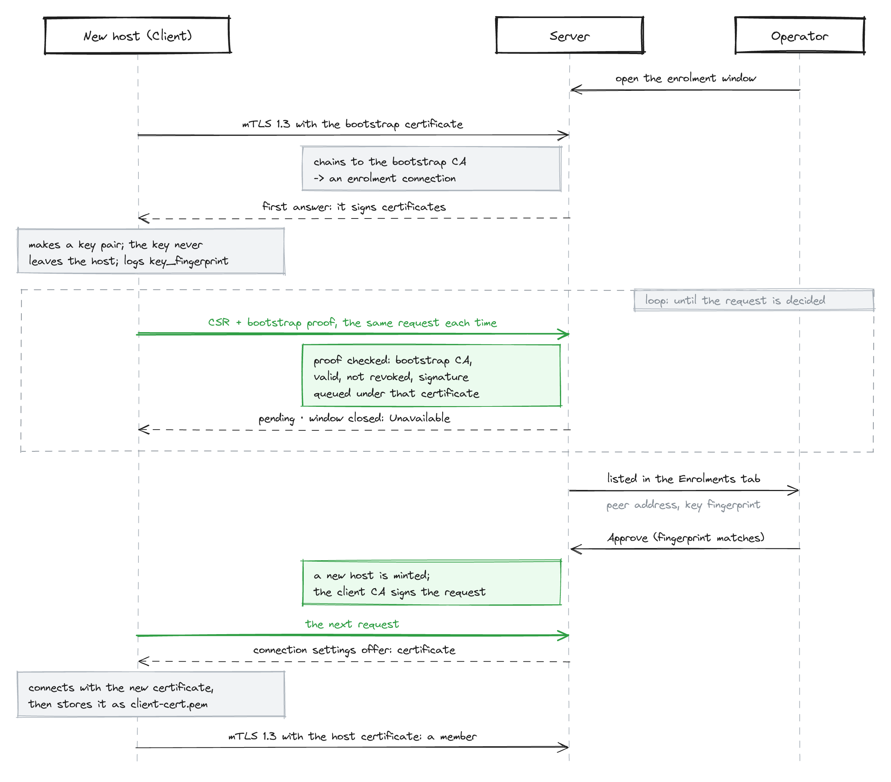
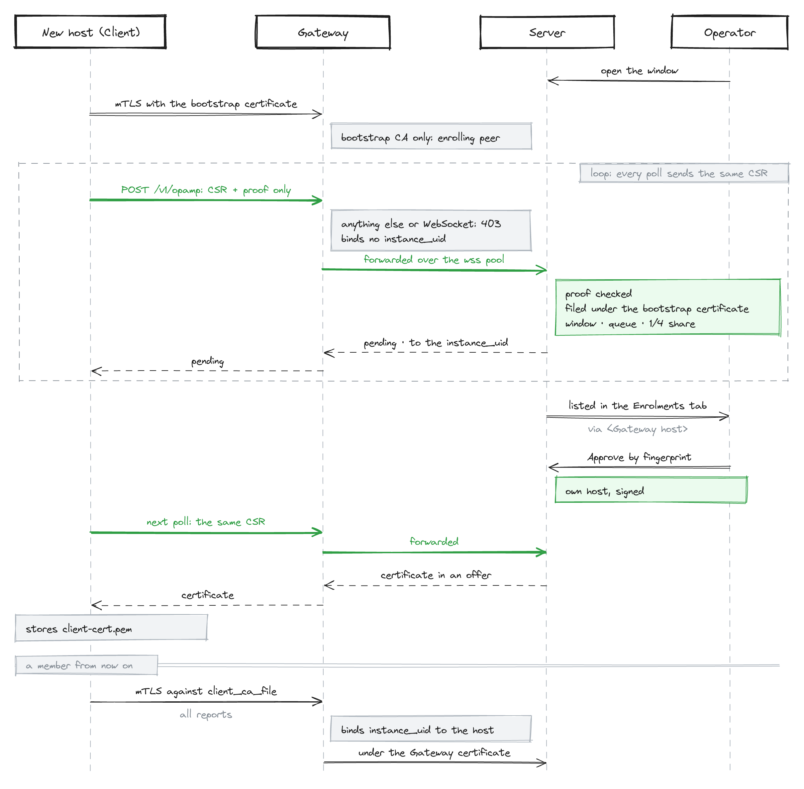
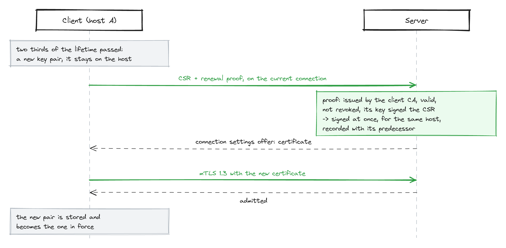
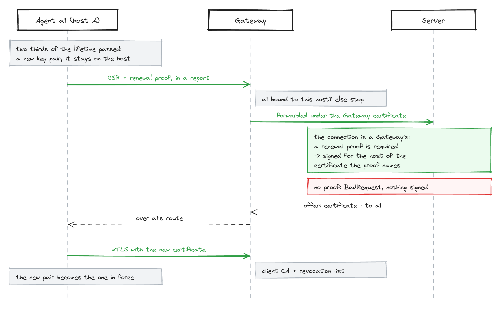

# A host's life: installation, enrolment, updates

[← User Manual](README.md) · [Setting up a fleet](setup.md) · [The Client](client.md) · [Rollout walkthrough](rollout.md)

This page follows one managed host through its whole life, from the first file you copy to it to
the updates it takes years later. It says what happens at each stage, who acts, and where, and links
to the page that holds the detail. It assumes a running Server with enrolment configured; [Setting
up a fleet](setup.md) gets you there.

Everything here can be done in the Server's UI, and everything the UI does is a call to the REST
API, so a script can do the same. The API calls are on the pages this one links to.

- [At a glance](#at-a-glance)
- [1. Issue a bootstrap certificate](#1-issue-a-bootstrap-certificate)
- [2. Install the Client](#2-install-the-client)
- [3. Enrol the host](#3-enrol-the-host)
- [4. Certificates renew themselves](#4-certificates-renew-themselves)
- [5. Updates](#5-updates)
- [6. Taking a host out](#6-taking-a-host-out)

## At a glance

| Stage | Who acts | Where | What happens |
|---|---|---|---|
| 1. Bootstrap certificate | you, once per customer, site or batch | **Enrolments** tab | The Server issues a short-lived certificate that lets a new host ask to join, and nothing more. |
| 2. Installation | you, on the host | the host | The Client is installed as a service and told the Server's address, the server CA and the bootstrap certificate. |
| 3. Enrolment | the host asks, you approve | **Enrolments** tab | The host makes its own key and asks for a certificate. You approve it, and the Server signs it. |
| 4. Renewal | nobody | — | The host replaces its certificate on its own, long before it ends. |
| 5. Updates | you release, the host installs | **Packages** and **Deployments** tabs | A signed Package reaches the hosts of a channel. Each host verifies it, installs it, and rolls back what will not run. |
| 6. Removal | you | REST API | Revoking the host's certificate shuts it out at once. |

## 1. Issue a bootstrap certificate

A new host has no certificate of the fleet yet, so it cannot connect as a member. It gets a
**bootstrap certificate** instead: one that lets it into the enrolment queue and nowhere else. The
Server issues it on your request.

In the UI, open the **Enrolments** tab and go to **Bootstrap certificates**:

1. Fill in what the hosts' certificates are to carry: the **country** (C, chosen from a list), the
   **state** (ST), the **locality** (L), the **customer** (O), the **site** (OU) and a **customer
   number** (organizationIdentifier). The customer and the site are required, so every host names
   both and a Selector on them reaches it; the others are optional. The approver sees them on every request
   this certificate carries, every host certificate issued from it carries them, and its Agents
   carry them as `fleet.host.*` for Selectors to match. They grant nothing. A value stays until a
   host enrols again, so name only what is stable.
2. Set how many **days** it is valid: 10 by default, 90 at most. Choose the time it takes to set the
   hosts up.
3. Type a **password**, twice; it is required. The certificate and its key come as one file,
   `bootstrap.p12`, encrypted under that password.
4. Press **Issue**. The new certificate appears in the list with its serial and end.
5. In its row, press **Save bootstrap.p12**.

**The file stays available.** The Server keeps `bootstrap.p12` and offers it in every later visit
to the page, until the certificate ends or is revoked; the private key never leaves the Server in
any other form. It does not keep the password: hand that to whoever installs the hosts by another
way than the file, a phone call rather than the same mail. A host that needs the pair as PEM
takes it out of the file with `opamp-fleetctl pki p12-extract` ([`pki`](tools.md#pki)).

One pair may go to every host of that customer or site. It opens nothing on its own: a host that
holds it can ask for a certificate only while the enrolment window is open, and gets one only
when you approve it. To withdraw a pair early, press **Revoke** in its row. A revoked certificate
stays in the list until it ends; **Delete** in its row removes it sooner, and it stays revoked.

Details: [Bootstrap certificates, issued by the Server](server.md#bootstrap-certificates-issued-by-the-server).

## 2. Install the Client

Each host needs the server CA and the bootstrap certificate, best kept in one directory such as
`/etc/opamp/`:

| File | From | Notes |
|---|---|---|
| `server-ca.pem` | the offline directory `pki init` made | The Client trusts this CA, and only it. |
| `bootstrap.p12` | step 1 | Or the two files below. The install asks for its password, or reads it from a file. |
| `bootstrap.pem` | `opamp-fleetctl pki p12-extract` from `bootstrap.p12` | |
| `bootstrap-key.pem` | `opamp-fleetctl pki p12-extract` from `bootstrap.p12` | Readable by root only. |

Install the Client from the release's `.deb`, `.rpm` or `.msi`. The package registers the service
and leaves it stopped. Then configure it in one of two ways:

- **Interactively**, once you have [opened the enrolment window](#3-enrol-the-host):
  `sudo opamp-fleet service install --interactive` asks for the Server's address, the host's name,
  the three files and the package verification key, writes the configuration, and enrols the host
  on the spot. It waits for your approval and shows the key fingerprint to approve. On Windows, run
  it in an elevated shell.
- **From a script**, which suits configuration management: after the package, run
  `sudo opamp-fleet service install --endpoint <address> --fleet-files /etc/opamp`, adding
  `--bootstrap-password-file <file>` for a `bootstrap.p12`. It enrols the host and waits for your
  approval, then `systemctl start opamp-fleet`. The package's own install never waits.
- **With a file**: write `supervisor.toml` naming the server CA and the PEM pair, then start the
  service. It enrols when it starts. A `bootstrap.p12` cannot be named there.

The bootstrap certificate is used only for this first request. Once the host holds its own
certificate, the bootstrap files, and a password file, can be removed.

Details: [Configure and install a Client](setup.md#4-configure-and-install-a-client) and
[Installing from a native package](client.md#installing-from-a-native-package).

## 3. Enrol the host

Enrolment turns a host with a bootstrap certificate into a member of the fleet. It needs an open
window and your approval, and the host's private key never leaves the host.

1. **Open the window.** In the **Enrolments** tab, choose how long (15 minutes, 1 hour or 4 hours)
   and press **Open window**. Outside the window, the Server turns every bootstrap certificate away.
2. **The host asks.** It connects with the bootstrap certificate, makes a key of its own, and sends
   a certificate request. It logs the key's fingerprint:

   ```console
   $ journalctl -u opamp-fleet | grep key_fingerprint
   INFO certificate request generated; an enrolling host waits for an operator's approval key_fingerprint=3f9a…
   ```

3. **The request waits in the queue.** The **Enrolments** tab lists it with its arrival time, the
   address it came from — or the Gateway it came through — the key fingerprint, and the bootstrap certificate it carries: customer,
   site, serial and end. A certificate the Server did not issue is marked *not issued here*.
4. **Check two things, then approve.** The key fingerprint must match the one the host logged, and
   the bootstrap certificate must be the one you gave that host. Press **Approve**. Press **Reject**
   for a request you do not recognise.
5. **The host becomes a member.** The Server signs its request with the client CA. The host stores
   the certificate in its state directory, reconnects with it, and appears on the **Agents** tab
   within seconds.
6. **Close the window** with **Close window** when you are done. It also closes when its time runs
   out, and when the Server restarts.



A host behind a Gateway enrols through it over `https://`, once the Gateway names the bootstrap
CA's certificate as `[gateway.tls] bootstrap_ca_file`; see
[Enrolment through a Gateway](client.md#enrolment-through-a-gateway). The Gateway relays the
request and nothing else, and the Server decides it as any other:



Details: [Enrol the Client](setup.md#5-enrol-the-client) and
[Enrolment: the first certificate](client.md#enrolment-the-first-certificate).

## 4. Certificates renew themselves

A host certificate lives 30 days by default. Two thirds of the way through its life, the Client
makes a new key, asks for a new certificate with the one it holds, and switches once it has
connected with the new one. No window and no approval is needed.



Behind a Gateway the request travels as an ordinary report. The Server sees the Gateway's
certificate on that connection, so it signs only a request with a renewal proof, and signs it for
the host of the certificate the proof names:



A host that stays offline longer than its certificate lives cannot renew. It has to enrol again,
as [Living with the certificates](setup.md#6-living-with-the-certificates) describes.

## 5. Updates

A Client updates two kinds of software in the same way: the agents it supervises, and itself.

### How an update travels

```text
Package            Deployment                    Client, on each host
(agent type,  ──▶  (channel,              ──▶    download ─▶ verify ─▶ install ─▶ health check
 version,           Packages)                                                      └─▶ roll back
 one signed         rollout act
 binary per
 platform)
```

- A **Package** is what an agent type runs at a version, with one binary per platform and your
  signature on each. On its own, it reaches nobody.
- A **Deployment** is a channel: a Selector that names the hosts it aims at, such as
  `channel = stable`, the Packages it offers, and the Configurations that go with them. A host
  belongs to at most one Deployment.
- The **rollout act** releases the Deployment — its Packages and its Configurations together — to
  the hosts it claims. Nothing changes on any host before it.
- The **Client** takes a package only when its `[packages] verification_key` is set, and only when
  the binary's hash and signature verify. It installs the binary, restarts the program, and checks
  that it stays up. A version that does not stay up is rolled back to the one before.

A Package reaches a host only as an **upgrade**: never the version it runs, never an older one. To
take a bad version back, publish the old content as a new, greater version and roll that out.

### Releasing an update in the UI

1. **Packages** tab: press **＋ Create**, enter the agent type and the version, and give the first
   platform's binary as a file. A file named
   `<agent type>_<version>_<os>_<arch>.tar.gz` fills the fields by itself. Press **OK**, then add
   each further platform with **＋ Add entry**.
2. Still there, select the Package and press **Signing info**. Compare every SHA-256 in the file
   with an independent source, then sign the file on the machine that holds the signing key:

   ```console
   $ opamp-fleetctl package sign --key fleet-signing.pk8 --signing-info promtail_3.1.0_signing.json
   ```

   Back on the **Packages** tab, choose the signed file and press **Import signing file**. Each
   binary can also be signed on its own in its field. With the Server's `[packages]
   verification_key` set, each entry shows whether its signature is valid.
3. **Deployments** tab: select the channel, add the Package (it replaces the older version of that
   agent type), and press **OK**.
4. Check the row's counts: how many hosts the channel claims, and how many the rollout would move.
   Press **Roll out (n)**.
5. **Agents** tab: each host shows its progress, `Downloading` with percent and speed, then
   `Installing`, then `Installed` or `InstallFailed` with the reason.

A host that joins the channel after the rollout is not updated by itself. Its row on the **Agents**
tab shows the Package waiting, with a **roll out** control of its own.

Try a release on a few hosts first: give them a channel of their own (`channel = canary`), roll out
there, then give the stable channel the same version.

Details: [Rollout walkthrough](rollout.md), [Signing a whole Package at
once](tools.md#signing-a-whole-package-at-once) and [Package updates](client.md#package-updates).

### The Client updates itself the same way

The Client is always an Agent of its own, of the agent type `supervisor`. A Package of that type,
made from the release archives `supervisor_<version>_<os>_<arch>.tar.gz` as they are published,
updates the Client itself.

On the host, the new version is staged beside the running one and checked before anything
switches: it must start on this host and report the version offered. The Client then stops as
on any service stop and lets the service manager start the new version, which commits itself once
it reaches the Server. A version that will not stay up is rolled back to its predecessor after
three attempts. Either way, the Server is
told the outcome.

Self-update needs the Client to run as an installed service. To hold a host on its version, set
`self_update = false` under `[packages]`.

Details: [Updating the Client itself](client.md#updating-the-client-itself).

## 6. Taking a host out

Revoke the host's certificate by its serial. The Server closes its sessions at once and refuses it
from then on, including any renewal. The certificates are listed under `GET /api/v1/certificates`:
revoke the one the host enrolled with, and the revocation reaches every renewal of it.

Details: [Living with the certificates](setup.md#6-living-with-the-certificates) and
[Revocation](server.md#revocation-withdrawing-a-certificate).
